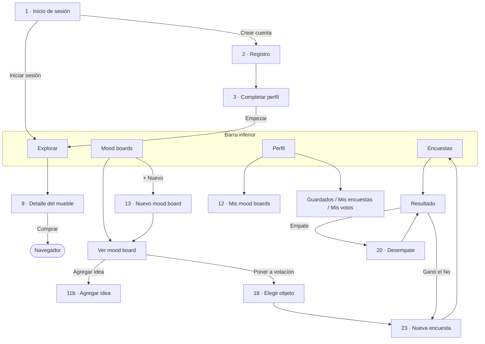

# Fase 1 · Propuesta (versión simple, estilo "cafe-app")

Esta versión reemplaza a la anterior. El código va a seguir el mismo estilo de la plantilla de clase **cafe-app** que me enviaste:

- JavaScript (`.jsx`), sin TypeScript.
- Los componentes van en `assets/Components` y los estilos en `assets/Styles/Stylesheet.jsx`.
- Las pantallas van en `src/app`.
- Se usan `useState`, `useEffect` y `FlatList`/`ScrollView`.

El diseño sale del Figma (página **Mockups**, 27 pantallas). Ignoro la página **copia**, que es una versión vieja.

---

## 1. Cómo se va a ver el código

Igual que en la plantilla: una función por componente, props entre llaves y `export default` al final.

```jsx
import { Pressable, Text } from "react-native";
import { chip } from "../Styles/Stylesheet";

// Props: texto, seleccionado (true o false), alPresionar (función)
function Chip({ texto, seleccionado, alPresionar }) {
  return (
    <Pressable
      style={seleccionado ? chip.contenedorActivo : chip.contenedor}
      onPress={alPresionar}
    >
      <Text style={seleccionado ? chip.textoActivo : chip.texto}>{texto}</Text>
    </Pressable>
  );
}

export default Chip;
```

Los datos se piden con funciones, igual que `getProductos()` en la plantilla. Hoy leen los datos de prueba; más adelante se cambian por `axios` + Supabase sin tocar las pantallas.

```jsx
import muebles from "../Datos/muebles";

// HOY: devuelve los muebles de prueba, de 10 en 10.
// MAÑANA: axios.get("https://TU-PROYECTO.supabase.co/rest/v1/muebles", ...)
async function obtenerMuebles(pagina, categoria) {
  let lista = muebles;
  if (categoria !== "Todo") {
    lista = muebles.filter(function (mueble) {
      return mueble.categoria === categoria;
    });
  }
  return lista.slice(pagina * 10, pagina * 10 + 10);
}

export { obtenerMuebles };
```

### Qué cambia respecto a la primera propuesta

| Antes | Ahora (como la plantilla) |
|---|---|
| TypeScript (`.tsx`) | JavaScript (`.jsx`) |
| Zustand para el estado global | `useState` + un Contexto de React (`useContext`) |
| Unos 45 componentes con nombres en inglés | 20 componentes con nombres en español |
| Carpetas `theme`, `services`, `logic` | Todo dentro de `assets/`, como en la plantilla |
| Lista *masonry* con librería (FlashList) | Dos columnas en un `ScrollView`, igual que el Figma (`col-1` / `col-2`) |
| Guardar los datos en el teléfono (AsyncStorage) | Los datos viven mientras la app está abierta |

---

## 2. Carpetas del proyecto

```
roomies-deco/
├── src/app/                        ← pantallas (cada archivo es una pantalla)
├── assets/
│   ├── Components/                 ← componentes reutilizables (uno por archivo)
│   ├── Styles/
│   │   ├── Tema.jsx                ← colores, letras y espacios sacados del Figma
│   │   └── Stylesheet.jsx          ← estilos (StyleSheet.create), como en la plantilla
│   ├── Datos/                      ← datos de prueba: usuarios, casa, muebles, moodboards, encuestas
│   ├── Servicios/                  ← funciones para pedir y guardar datos (hoy locales)
│   ├── Logica/                     ← reglas de votación, desempate, sugerencias y paleta
│   ├── Contexto/AppContexto.jsx    ← datos compartidos entre pantallas
│   └── images/muebles/             ← fotos de los muebles
├── app.json
├── package.json
└── GUIA.md
```

---

## 3. Colores y letras del Figma (`Tema.jsx`)

```jsx
const colores = {
  fondo: "#FAF5EE",          // fondo de todas las pantallas
  superficie: "#FFFFFF",     // tarjetas, cajas de texto
  borde: "#E8DED2",          // bordes y divisores
  texto: "#2B2420",          // texto principal
  textoSuave: "#8A817A",     // etiquetas y precios
  principal: "#D9653B",      // botones, chip activo, pestaña activa
  principalSuave: "#F6DDD0", // avatares, sugerencia elegida
  verdeSuave: "#DDE7DD",     // aviso de ganador
  amarilloSuave: "#FCEBC6",  // aviso "Ganó el No"
  meGusta: "#3E8E5A",        // botón "Me gusta" y barras positivas
  noMeGusta: "#C8453B",      // botón "No me gusta" y barras negativas
};
```

| Estilo | Letra | Tamaño |
|---|---|---|
| Título grande | Poppins Bold | 28 |
| Título | Poppins Bold | 22 |
| Subtítulo | Poppins SemiBold | 16 |
| Texto | Inter Regular | 16 |
| Texto fuerte | Inter SemiBold | 16 |
| Etiqueta | Inter SemiBold | 14 |
| Texto pequeño | Inter Regular | 12 |

**Bordes redondeados:**
- 16: tarjetas, cajas y botones.
- 999: chips y círculos.
- 12: fotos pequeñas.
- 24: foto del detalle.

**Márgenes:** 16 a los lados de la pantalla.

**Íconos:** Lucide (`lucide-react-native`), los mismos del Figma.

---

## 4. Pantallas (`src/app`)

| Archivo | Pantalla del Figma |
|---|---|
| `index.jsx` | 1 · Inicio de sesión (la primera pantalla, como en la plantilla) |
| `registro.jsx` | 2 · Registro |
| `completar-perfil.jsx` | 3 · Completar perfil |
| `(tabs)/_layout.jsx` | Barra inferior con 4 pestañas |
| `(tabs)/explorar.jsx` | 4, 6, 7, 8 · Explorar (con chips de categorías) |
| `(tabs)/encuestas.jsx` | 22 · Encuestas activas |
| `(tabs)/moodboards.jsx` | 10, 10b · Mood boards (Todos / Mis moodboards) |
| `(tabs)/perfil.jsx` | 26 · Perfil |
| `mueble/[id].jsx` | 9 · Detalle del mueble |
| `moodboard/nuevo.jsx` | 13 · Nuevo mood board |
| `moodboard/[id].jsx` | 11, 14, 15, 17 · Ver un mood board |
| `agregar-idea/[id].jsx` | 11b · Agregar idea |
| `elegir-objeto/[id].jsx` | 18 · Poner a votación (elegir un objeto) |
| `encuesta/nueva.jsx` | 23 · Nueva encuesta |
| `encuesta/[id].jsx` | 24, 25, 25b, 19, 21 · Resultado (aprobado, no ganó, empate, decisión final) |
| `desempate/[id].jsx` | 20 · Votación de desempate |
| `mis-moodboards.jsx` | 12 · Mis mood boards |
| `guardados.jsx` | **(nueva)** Muebles guardados |
| `mis-encuestas.jsx` | **(nueva)** Encuestas que creé |
| `mis-votos.jsx` | **(nueva)** Votos que di |

`[id]` significa que la pantalla recibe un dato. Por ejemplo, `mueble/m1` abre el detalle del mueble `m1`.

### Navegación



---

## 5. Componentes (`assets/Components`)

| Componente | Para qué sirve | Props |
|---|---|---|
| `Boton` | Botón grande naranja o con borde | `texto`, `alPresionar`, `tipo` ("principal" o "secundario"), `deshabilitado` |
| `Chip` | Botón pequeño redondeado (filtros y opciones) | `texto`, `seleccionado`, `alPresionar` |
| `CampoTexto` | Etiqueta + caja para escribir | `etiqueta`, `valor`, `alCambiar`, `placeholder`, `esContrasena` |
| `Buscador` | Barra de búsqueda con lupa | `valor`, `alCambiar` |
| `Encabezado` | Título de la pantalla, con o sin flecha para volver | `titulo`, `subtitulo`, `conVolver`, `botonDerecha` |
| `TarjetaMueble` | Foto + nombre + precio (feed) | `mueble`, `altoFoto`, `alPresionar`, `mostrarMas`, `alAgregar` |
| `GrillaMuebles` | Las dos columnas tipo Pinterest | `muebles`, `alPresionarMueble`, `mostrarMas`, `alAgregar` |
| `TarjetaTienda` | "Disponible en Homecenter" | `tienda`, `alPresionar` |
| `TarjetaMoodboard` | Mini collage + título + subtítulo | `titulo`, `subtitulo`, `fotos`, `alPresionar` |
| `Collage` | Fotos grandes de un mood board | `fotos` |
| `Paleta` | Círculos de colores | `colores`, `alAgregar` |
| `TarjetaEncuesta` | Tarjeta de la lista de encuestas, con botones para votar | `encuesta`, `alVotar`, `alAbrir` |
| `BotonVoto` | "Me gusta" verde o "No me gusta" rojo | `texto`, `tipo` ("si" o "no"), `seleccionado`, `alPresionar` |
| `BarraResultado` | Opción + votos + barra de color | `texto`, `votos`, `total`, `tipo` |
| `Aviso` | Recuadro de mensaje (verde o amarillo) | `texto`, `tipo` ("exito", "info" o "alerta") |
| `Avatar` | Círculo con iniciales | `iniciales`, `tamano`, `color` |
| `TarjetaOpcion` | Fila con foto, textos y círculo para elegir | `foto`, `titulo`, `subtitulo`, `seleccionado`, `alPresionar` |
| `TarjetaEstadistica` | Número grande + etiqueta (perfil) | `numero`, `etiqueta`, `alPresionar` |
| `FilaAjuste` | Fila del perfil con ícono y flecha o interruptor | `icono`, `texto`, `alPresionar`, `derecha` |
| `EstadoVacio` | Mensaje cuando una lista está vacía | `titulo`, `mensaje` |

---

## 6. Modelo de datos (`assets/Datos`)

Son listas de objetos, como las filas de una tabla de Supabase. Así, el día que se conecte la base de datos, cada archivo se convierte en una tabla.

| En el requerimiento | En el código | Ejemplo |
|---|---|---|
| User | `usuario` | `{ id: "u1", nombre: "Ana Gómez", correo: "ana@email.com", contrasena: "1234", iniciales: "AG", convive: "Roomies", vibras: ["Cálido", "Natural"], id_casa: "c1", guardados: ["m1", "m5"], notificaciones: true }` |
| House | `casa` | `{ id: "c1", nombre: "Apartamento", integrantes: ["u1", "u2", "u3"] }` |
| Furniture | `mueble` | `{ id: "m1", nombre: "Sofá 3 puestos", categoria: "Sofás", precio: 890000, imagen: require(...), tienda: "Homecenter", url_tienda: "https://...", largo: 210, ancho: 90, alto: 85, color: "Verde oliva", materiales: ["Tela", "Madera"], descripcion: "...", colores: ["#6B7A4F", "#C9A77C"] }` |
| Moodboard | `moodboard` | `{ id: "mb1", nombre: "Sala acogedora", id_dueno: "u1", ideas: [{ id: "i1", id_mueble: "m1" }, { id: "i2", foto: "file://..." }], colores: [...], vibras: ["Cálido"], descripcion: "...", compartido: true }` |
| Poll | `encuesta` | `{ id: "e1", id_moodboard: "mb1", id_idea: "i1", id_creador: "u1", pregunta: "¿Lo ponemos en la sala?", texto_si: "Me gusta", texto_no: "No me gusta", cierra: "2026-11-06T18:00", estado: "activa", ronda: 1 }` |
| Vote | `voto` | `{ id: "v1", id_encuesta: "e1", id_usuario: "u2", ronda: 1, valor: "si" }` |

**Datos de prueba:**
- 1 casa ("Apartamento") con 3 roommates: Ana, Mateo y Valentina, cada uno con su cuenta demo.
- Unos 32 muebles con foto.
- 4 o 5 mood boards.
- Encuestas en distintos estados.

### Cómo viajan los datos

```
assets/Datos  →  assets/Servicios  →  AppContexto (useState)  →  pantallas (useContext)
(datos de prueba)  (funciones)         (datos compartidos)        (lo que se ve)
```

**`AppContexto.jsx`** es como una caja compartida:
- **Guarda** el usuario que inició sesión, los mood boards, las encuestas y los votos.
- **Tiene funciones** como `iniciarSesion`, `guardarEnMoodboard`, `crearEncuesta` y `votar`.

Cualquier pantalla la usa así:

```jsx
const { encuestas, votar } = useContext(AppContexto);
```

Para probar con varios roommates en un mismo teléfono: cierras sesión y entras con otra cuenta demo. Los votos se mantienen mientras la app esté abierta.

---

## 7. Cómo funciona la votación (se programa en la Fase 4)

1. **Crear.**
   - Desde un mood board se elige UN objeto.
   - Se escribe la pregunta y los textos de los dos botones. Por defecto son "Me gusta / No me gusta" y se pueden cambiar, por ejemplo a "Sí, pongámoslo / No, busquemos otro".
   - Se elige cuándo cierra: 24 h, 48 h o 3 días.
2. **Votar.**
   - Cada roommate vota una vez desde la lista o desde el detalle, y puede cambiar su voto mientras la encuesta esté abierta.
   - Solo se ven los totales ("Votaron 2 de 3"), no quién votó qué.
3. **Cerrar.**
   - La encuesta se cierra cuando votan todos o cuando se acaba el tiempo.
   - Quien la creó puede cerrarla antes. Eso sirve para probar un empate sin esperar 24 horas.
4. **Contar.**
   - Más "sí" que "no": se aprueba y aparece "Comprar mueble".
   - Más "no" que "sí": no ganó y se muestran sugerencias.
   - Igual número de "sí" y "no": empate.
5. **Desempatar.**
   - Mecanismo 1, el del Figma: una ronda anónima donde votan todos otra vez.
   - Mecanismo 2, para que siempre termine: si después de 2 rondas sigue el empate, el mueble no se pone y se muestran sugerencias.
6. **Sugerir alternativas.**
   - Se buscan objetos en los mood boards de todos los roommates.
   - Se prefieren los de la misma categoría, los que aparecen en más mood boards y los de colores parecidos.
   - Se muestran los 3 mejores, con "Coincide con Ana y Mateo".

---

## 8. Lo que el Figma no muestra y cómo lo resuelvo

| Falta en el Figma | Propuesta |
|---|---|
| Medidas, color y materiales en el detalle | Tres recuadros "Largo / Ancho / Alto" (como los del perfil) y chips para color y materiales |
| Fotos del carrete para el mood board | Una casilla punteada "+ Fotos" en la grilla de ideas, con `expo-image-picker` |
| Paleta automática | Se achica la foto a pocos píxeles, se cuentan los colores que más se repiten y se muestran los 5 principales. Los muebles de prueba ya traen sus colores |
| "Qué combina (paredes, pisos, luces, muebles)" | Debajo de la paleta: el color más claro para paredes, el más oscuro para pisos, el más fuerte para muebles y luz cálida o fría |
| Botón "Cargar más ideas" vs. scroll infinito | Las ideas se cargan solas al bajar. El botón aparece solo si falla la carga |
| Perfil: guardados, encuestas creadas y votos dados | Las estadísticas se pueden tocar y se agregan dos filas en "Mi casa" |
| Ajustes de notificaciones | El interruptor del Figma más "Nuevas encuestas" y "Resultados". Solo se guarda la preferencia |
| Listas vacías, errores y cargas | Un mensaje con el estilo del Figma, un aviso amarillo con "Reintentar" y un indicador de carga naranja |
| "Usuario 1/2/3" e "Inquilino 4" | Nombres reales de los 3 roommates demo |

---

## 9. Decisiones que necesito de ti

1. **Botón del detalle del mueble.** El Figma dice "Guardar en Encuestas" y tu requerimiento dice guardarlo en un moodboard. Propongo "Guardar en moodboard".
2. **Opciones de la encuesta.** Propongo dos opciones con textos editables y quitar "+ Agregar opción". La alternativa es una tercera opción neutral, "Me da igual".
3. **Desempate.** Propongo hasta 2 rondas anónimas y, si sigue el empate, que el mueble no se ponga.
4. **Fotos extra.** El Figma solo tiene 21 fotos, y no hay camas, clósets ni tocadores. ¿Puedes pegar unas 10–12 en una página nueva del Figma duplicado?
5. **Nombre de la app.** Si no me dices otro, uso "Roomies Deco".
6. **Versión de Expo.** La plantilla usa el SDK 57, pero la versión más reciente es la 58 (septiembre de 2026), y Expo Go de la tienda abre la más reciente. Propongo el **SDK 58**, salvo que tu profesor pida el 57.

## 10. Ajustes del entorno antes de la Fase 2

- **Permitir `www.figma.com` en la red.** Sin eso, los íconos y las fotos del Figma solo me llegan en baja resolución.
- **Conectar GitHub y crear un repositorio vacío.** Así no se pierde el trabajo entre fases.
