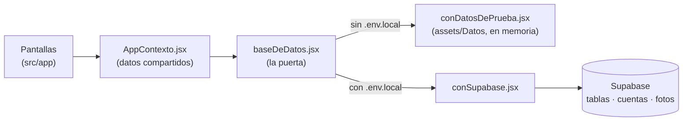

# Cómo conectar Roomies Deco a Supabase

Esta guía es para quien va a conectar la app a una base de datos real en **Supabase**. No necesitas experiencia previa con Supabase: cada paso dice exactamente qué tocar y cómo saber que salió bien.

**Tiempo:** entre 45 minutos y 1 hora.

**Lo que necesitas:**

- El proyecto abierto en VS Code y funcionando con los datos de prueba (ver la sección 1 de `GUIA.md`).
- Una cuenta en [supabase.com](https://supabase.com) (es gratis; puedes entrar con tu cuenta de GitHub).

> **Lo más importante:** la parte de programación ya está hecha. La app ya sabe hablar con Supabase (archivo `assets/Servicios/conSupabase.jsx`) y ya está probada. Tu trabajo es **crear la base de datos en Supabase, cargarle los datos y darle a la app la dirección y la clave**. No tienes que cambiar ninguna pantalla.

---

## Contenido

1. [Cómo está hecha la app (2 minutos de lectura)](#cómo-está-hecha-la-app)
2. [Paso 1. Crear el proyecto en Supabase](#paso-1-crear-el-proyecto-en-supabase)
3. [Paso 2. Apagar la confirmación por correo (mientras prueban)](#paso-2-apagar-la-confirmación-por-correo-mientras-prueban)
4. [Paso 3. Crear las tablas, la seguridad y las carpetas de fotos](#paso-3-crear-las-tablas-la-seguridad-y-las-carpetas-de-fotos)
5. [Paso 4. Cargar la casa y el catálogo de muebles](#paso-4-cargar-la-casa-y-el-catálogo-de-muebles)
6. [Paso 5. Subir las 21 fotos de los muebles](#paso-5-subir-las-21-fotos-de-los-muebles)
7. [Paso 6. Crear las 3 cuentas de prueba y sus datos](#paso-6-crear-las-3-cuentas-de-prueba-y-sus-datos)
8. [Paso 7. Conectar la app](#paso-7-conectar-la-app)
9. [Paso 8. Probar que todo funciona](#paso-8-probar-que-todo-funciona)
10. [Cómo funciona por dentro](#cómo-funciona-por-dentro)
11. [Cómo hacer cambios](#cómo-hacer-cambios)
12. [Problemas comunes](#problemas-comunes)
13. [Antes de publicar la app](#antes-de-publicar-la-app)
14. [Volver a los datos de prueba](#volver-a-los-datos-de-prueba)
15. [Palabras que vas a ver](#palabras-que-vas-a-ver)

---

## Cómo está hecha la app

Las pantallas nunca le piden los datos directamente a Supabase. Todo pasa por un solo archivo, `assets/Servicios/baseDeDatos.jsx`, que decide de dónde salen:



- **Sin el archivo `.env.local`**, la app usa los datos de prueba, como hasta ahora.
- **Con el archivo `.env.local`** (lo creas en el paso 7), la app usa Supabase.

Las dos opciones tienen las mismas funciones y devuelven los datos con la misma forma. Por eso las pantallas funcionan igual con las dos.

### Los archivos que vas a usar

| Archivo | Para qué |
|---|---|
| `supabase/1-tablas.sql` | Crea las 8 tablas |
| `supabase/2-seguridad.sql` | Las reglas de quién ve y cambia qué |
| `supabase/3-fotos.sql` | Las carpetas de fotos |
| `supabase/4-catalogo.sql` | La casa "Apartamento" y los 21 muebles |
| `supabase/5-datos-de-prueba.sql` | Los perfiles, mood boards, encuestas y votos de Ana, Mateo y Valentina |
| `.env.ejemplo` | La plantilla del archivo `.env.local` |
| `assets/images/muebles/` | Las 21 fotos del catálogo |

Los archivos `.sql` se corren **en orden** y **una sola vez**.

---

## Paso 1. Crear el proyecto en Supabase

1. Entra a [supabase.com](https://supabase.com) y toca **Sign in** (puedes usar tu cuenta de GitHub).
2. Toca **New project**.
3. Llena los datos:
   - **Name:** `roomies-deco`
   - **Database Password:** inventa una contraseña y **guárdala** en un lugar seguro. La app no la usa, pero la puedes necesitar después.
   - **Region:** la más cercana a Colombia, por ejemplo *East US (North Virginia)* o *South America (São Paulo)*.
4. Toca **Create new project** y espera uno o dos minutos mientras Supabase lo prepara.

✅ **Cómo sabes que salió bien:** ves el panel de tu proyecto. A la izquierda hay un menú con *Table Editor*, *SQL Editor*, *Authentication*, *Storage*, etc.

---

## Paso 2. Apagar la confirmación por correo (mientras prueban)

Supabase, al crear una cuenta, envía un correo para confirmarla. Mientras prueban es más fácil apagarlo, para que las cuentas nuevas entren de una vez.

1. En el menú de la izquierda, entra a **Authentication**.
2. Busca **Sign In / Providers** (en algunas versiones se llama **Providers**) y abre **Email**.
3. Apaga **Confirm email** y toca **Save**.

✅ **Cómo sabes que salió bien:** *Confirm email* queda apagado.

> Antes de publicar la app lo vas a volver a encender (ver [Antes de publicar la app](#antes-de-publicar-la-app)). La app ya está preparada para eso: si la confirmación está encendida, al crear la cuenta muestra "Te enviamos un correo para confirmar la cuenta".

---

## Paso 3. Crear las tablas, la seguridad y las carpetas de fotos

Aquí vas a correr los archivos 1, 2 y 3. Los tres se corren igual:

1. En VS Code, abre el archivo (por ejemplo `supabase/1-tablas.sql`).
2. Selecciona todo con `Ctrl + A` (en Mac, `Cmd + A`) y cópialo con `Ctrl + C`.
3. En Supabase, entra a **SQL Editor** y toca **New query** (o el botón **+**).
4. Pega con `Ctrl + V` y toca **Run** (o `Ctrl + Enter`).
5. Abajo debe salir **Success. No rows returned**.

Hazlo con los tres archivos, en este orden:

| Orden | Archivo | Qué crea |
|---|---|---|
| 1 | `supabase/1-tablas.sql` | Las tablas `casas`, `usuarios`, `muebles`, `guardados`, `moodboards`, `ideas`, `encuestas` y `votos`, y un **disparador**: cuando alguien crea una cuenta, se crea su perfil en `usuarios` automáticamente |
| 2 | `supabase/2-seguridad.sql` | Las reglas de seguridad (RLS): cada persona solo ve lo de su casa y solo cambia lo suyo |
| 3 | `supabase/3-fotos.sql` | Dos carpetas de fotos en Storage: `muebles` (el catálogo) y `fotos` (las que sube la gente) |

✅ **Cómo sabes que salió bien:**

- En **Table Editor** ves las 8 tablas. Ninguna dice **Unrestricted** ni **RLS disabled** (eso querría decir que la seguridad está apagada).
- En **Storage** ves las carpetas `muebles` y `fotos`.

> **¿Salió un error?** Lee el mensaje rojo. Si dice que algo *already exists* ("ya existe"), es porque ese archivo ya se había corrido: no lo corras otra vez y sigue con el siguiente. Para empezar de cero, mira [Problemas comunes](#problemas-comunes).

---

## Paso 4. Cargar la casa y el catálogo de muebles

Corre `supabase/4-catalogo.sql` igual que en el paso 3.

Este paso va **antes** de crear cuentas, porque las cuentas nuevas entran a la casa que crea este archivo.

✅ **Cómo sabes que salió bien:** en **Table Editor**, la tabla `casas` tiene 1 fila ("Apartamento") y la tabla `muebles` tiene 21 filas.

---

## Paso 5. Subir las 21 fotos de los muebles

Cada mueble tiene en la columna `imagen` el nombre de su foto, por ejemplo `sofa-3-puestos.jpg`. Las fotos tienen que estar en la carpeta `muebles` de Storage **con ese mismo nombre**.

1. En Supabase, entra a **Storage** y abre la carpeta **muebles**.
2. Toca **Upload files**.
3. Busca la carpeta del proyecto `assets/images/muebles/`, selecciona las 21 fotos (`Ctrl + A`) y súbelas.
4. **No les cambies el nombre.**

✅ **Cómo sabes que salió bien:** la carpeta `muebles` tiene 21 archivos. Si tocas uno y luego **Get URL** (o **Copy URL**), la foto se abre en el navegador.

---

## Paso 6. Crear las 3 cuentas de prueba y sus datos

### 6a. Crear las cuentas

1. En Supabase, entra a **Authentication** → **Users**.
2. Toca **Add user** → **Create new user**.
3. Escribe:
   - **Email:** `ana@email.com`
   - **Password:** `123456`
   - Deja marcada la opción **Auto Confirm User**.
4. Toca **Create user**.
5. Repite con `mateo@email.com` y con `valentina@email.com`, con la misma contraseña.

> Con Supabase las contraseñas deben tener **al menos 6 caracteres**. Por eso aquí las cuentas de prueba usan `123456` y no `1234`, como en los datos de prueba.

✅ **Cómo sabes que salió bien:** en **Authentication → Users** ves las 3 cuentas. En **Table Editor → usuarios** hay 3 filas: el disparador creó los perfiles solo, por ahora con nombres como "ana".

### 6b. Cargar sus datos

Corre `supabase/5-datos-de-prueba.sql` igual que en el paso 3. Este archivo completa los perfiles (nombres, vibras, colores) y crea los guardados, los 5 mood boards, las 7 encuestas y los votos.

✅ **Cómo sabes que salió bien:** en **Table Editor**, `usuarios` tiene "Ana Gómez", "Mateo Ruiz" y "Valentina Díaz"; `encuestas` tiene 7 filas y `votos` tiene 20.

> Si sale el error **"Falta la cuenta ana@email.com"**, es porque esa cuenta no existe todavía: créala (paso 6a) y vuelve a correr el archivo.

---

## Paso 7. Conectar la app

### 7a. Copiar la dirección y la clave de tu proyecto

En Supabase, toca el botón **Connect** (arriba, en el centro), o entra a **Project Settings** (el engranaje) → **API Keys**. Copia dos cosas:

| Qué | Cómo se ve |
|---|---|
| **Project URL** | `https://abcdefghijklm.supabase.co` |
| **Publishable key** | Empieza por `sb_publishable_`. En proyectos viejos se llama **anon public** y es un texto largo que empieza por `eyJ` |

> ⚠️ **Nunca** uses en la app la clave **secret** (`sb_secret_…`) ni la **service_role**. Esas claves se saltan toda la seguridad, y cualquiera que tenga la app podría leerlas. La clave *publishable* sí puede ir en la app: lo que la protege son las reglas del paso 3.

### 7b. Crear el archivo `.env.local`

1. En VS Code, en la carpeta principal del proyecto (donde está `package.json`), busca el archivo **`.env.ejemplo`**.
2. Haz una copia y llámala **`.env.local`** (con el punto al principio).
3. Ábrela y cambia los dos valores por los tuyos:

   ```
   EXPO_PUBLIC_SUPABASE_URL=https://abcdefghijklm.supabase.co
   EXPO_PUBLIC_SUPABASE_KEY=sb_publishable_xxxxxxxxxxxxxxxx
   ```

   Sin comillas, sin espacios alrededor del `=` y sin `/` al final de la dirección.

> `.env.local` **no se sube a GitHub** (está en `.gitignore`). Cada persona del equipo crea el suyo.

### 7c. Instalar y arrancar

En la terminal de VS Code:

```bash
npm install
```

```bash
npx expo start --clear
```

El `--clear` es importante: Expo copia los valores de `.env.local` dentro de la app cuando la prepara, y sin `--clear` puede seguir usando la versión anterior.

✅ **Cómo sabes que salió bien:** en la pantalla de inicio de sesión **ya no aparece** el texto "Cuentas de prueba: …". Eso quiere decir que la app está usando Supabase. Entra con `ana@email.com` y `123456`.

---

## Paso 8. Probar que todo funciona

Haz estas pruebas en orden. En la columna de la derecha está dónde ver en Supabase que el cambio quedó guardado (en **Table Editor**, toca **Refresh** para ver los cambios).

| # | Qué hacer en la app | Qué debe pasar | Dónde verlo en Supabase |
|---|---|---|---|
| 1 | Entrar con `ana@email.com` y una contraseña equivocada | "El correo o la contraseña no coinciden." | — |
| 2 | Entrar con `ana@email.com` y `123456` | Explorar muestra los muebles **con sus fotos** | — |
| 3 | Buscar "lampara" (sin tilde) | Salen las 6 lámparas | — |
| 4 | En Encuestas, votar "Me gusta" en la "Lámpara de arco" | Ana es la última en votar: la encuesta se cierra y se abre el resultado | `encuestas`: la de la lámpara (id terminado en `…0002`) dice `aprobada` |
| 5 | En "Por desempatar", abrir "Love seat azul" → Desempatar → "No ponerlo" → Enviar | "Ganó el «No» en el desempate" y 3 sugerencias | `encuestas`: la `…0006` dice `rechazada`, ronda `2` |
| 6 | Mood boards → + Nuevo → nombre, una idea y una foto con "+ Fotos" → Guardar | Se abre el mood board con la foto | **Storage → fotos**: una carpeta con el id de Ana y la foto adentro; `ideas`: una fila con `foto` |
| 7 | Perfil → apagar Notificaciones | El interruptor queda apagado | `usuarios`: en la fila de Ana, `notificaciones` dice `"activas": false` |
| 8 | Recargar la página (o cerrar y abrir la app) | Sigues adentro: la sesión se guardó | — |
| 9 | Cerrar sesión → Crear cuenta con tu correo y una contraseña de 6 o más caracteres | Pasa a "Completa tu perfil" y después a Explorar | **Authentication → Users** y la tabla `usuarios`: tu cuenta |
| 10 | Abrir la app en dos lugares a la vez (por ejemplo, el navegador y el teléfono) con dos cuentas, y votar en uno | En menos de 30 segundos el voto aparece en el otro | `votos` |

Si todo esto funciona, la conexión está lista. 🎉

---

## Cómo funciona por dentro

No necesitas esta sección para conectar la app, pero te sirve para entenderla y cambiarla.

### La conexión: `assets/Servicios/clienteSupabase.jsx`

Crea la conexión con la dirección y la clave de `.env.local`. Guarda la sesión en el teléfono (con AsyncStorage) o en el navegador, para que no haya que iniciar sesión cada vez.

```jsx
cliente = createClient(process.env.EXPO_PUBLIC_SUPABASE_URL, process.env.EXPO_PUBLIC_SUPABASE_KEY, {
  auth: { storage: AsyncStorage, autoRefreshToken: true, persistSession: true, detectSessionInUrl: false },
});
```

### Las funciones: `assets/Servicios/conSupabase.jsx`

| Función | Qué hace en Supabase |
|---|---|
| `iniciarSesion` | `supabase.auth.signInWithPassword(...)` |
| `registrarse` | `supabase.auth.signUp(...)` con el nombre en `options.data`. El disparador de `1-tablas.sql` crea el perfil |
| `sesionGuardada` | `supabase.auth.getSession()`: ¿quedó alguien con sesión? |
| `cerrarSesion` | `supabase.auth.signOut()` |
| `cargarTodo` | Lee el perfil y después, al mismo tiempo, la casa, los roommates, los guardados, los mood boards con sus ideas, las encuestas, los votos y el catálogo |
| `obtenerMuebles` | Lee una página de 10 muebles con `.range(...)`, filtrando por categoría (`.eq`) y por texto (`.ilike` sobre la columna `busqueda`) |
| `guardarMueble` | `upsert` en `guardados` (si ya estaba, no hace nada) |
| `crearMoodboard` / `agregarIdea` | `insert` en `moodboards` e `ideas`. Si la idea es una foto, primero la achica y la sube a **Storage → fotos** |
| `crearEncuesta` | `insert` en `encuestas` |
| `guardarVoto` | `upsert` en `votos`: si la persona ya había votado en esa ronda, cambia su voto |
| `guardarCierre` | `update` del estado de la encuesta, **solo si nadie la cerró antes** (filtra por el estado y la ronda que tenía) |
| `actualizarPerfil` | `update` en `usuarios` (nombre, convive, vibras, notificaciones) |

Así se ve una de ellas:

```jsx
async function guardarVoto(idUsuario, idEncuesta, ronda, valor) {
  revisar(
    await obtenerCliente()
      .from("votos")
      .upsert(
        { id_encuesta: idEncuesta, id_usuario: idUsuario, ronda: ronda, valor: valor },
        { onConflict: "id_encuesta,id_usuario,ronda" }
      ),
    "guardar tu voto"
  );
}
```

Supabase siempre responde `{ data, error }`. La función `revisar` convierte el error en un mensaje en español ("No se pudo guardar tu voto. …"). La app lo muestra arriba de la pantalla con un botón **Cerrar**.

**De filas de Supabase a la forma de la app.** Las funciones `aMueble`, `aUsuario`, `aMoodboard` y `aEncuesta` convierten cada fila a la forma de los datos de prueba. Por ejemplo, la foto de un mueble pasa de `"sofa-3-puestos.jpg"` a `{ uri: "https://…/storage/v1/object/public/muebles/sofa-3-puestos.jpg" }`, y las fechas pasan de texto a milisegundos.

### La votación

Las reglas (cuándo se cierra una ronda y quién gana) están en `assets/Logica/votacion.jsx` y se explican en la sección 9 de `GUIA.md`. Con Supabase funcionan así:

- **Después de cada cambio**, la app vuelve a cargar los datos (`cargarTodo`). Si a alguna encuesta ya le toca cerrarse (votaron todos o se acabó el tiempo), la cierra con `guardarCierre`.
- **Cada 30 segundos**, mientras la app está abierta, hace lo mismo. Así ve los votos de los demás y cierra a tiempo las encuestas vencidas.
- **Si dos personas intentan cerrar la misma encuesta a la vez**, solo cuenta la primera: `guardarCierre` solo cambia la encuesta si todavía tiene el estado y la ronda que tenía antes.

### La seguridad (RLS)

| Tabla | Quién puede ver | Quién puede cambiar |
|---|---|---|
| `casas` | Los de esa casa | Nadie desde la app |
| `usuarios` | Los roommates de la casa | Cada uno su perfil: nombre, convive, vibras y notificaciones (no el correo ni la casa) |
| `muebles` | Todos los que iniciaron sesión | Nadie desde la app |
| `guardados` | Cada uno los suyos | Cada uno los suyos |
| `moodboards` | Los propios (también borradores) y los compartidos de la casa | Solo el dueño |
| `ideas` | Las de los mood boards que puedo ver | Puedo agregar ideas a los mood boards que puedo ver |
| `encuestas` | Las de la casa | Crear: cualquiera de la casa, a su nombre. Cerrar: cualquiera de la casa, pero solo el estado, la ronda y la hora de cierre |
| `votos` | Los de las encuestas de la casa | Cada uno su voto, solo en la ronda que está abierta |
| Storage `fotos` | Cualquiera con el enlace | Cada uno sube solo a su carpeta (`fotos/<su id>/…`) |

Quien no ha iniciado sesión no ve nada.

### Cómo se probó

Todo esto se probó antes de entregarlo, sin un proyecto real de Supabase:

- **El SQL** se corrió en un Postgres 16 preparado como Supabase (los roles `anon` y `authenticated`, la función `auth.uid()` y las tablas de cuentas y de fotos). Pasaron 25 pruebas de seguridad, por ejemplo que Mateo no ve el borrador de Ana y que nadie puede votar a nombre de otro.
- **La app completa** se probó en el navegador contra ese Postgres, con un servidor de prueba que responde como la API de Supabase y usando la librería real `@supabase/supabase-js`. Pasaron los 4 recorridos: Ana usando toda la app, registro de una cuenta nueva, cierre anticipado y desempate, y dos personas votando al mismo tiempo. También se probó el mensaje que sale cuando no hay conexión.

---

## Cómo hacer cambios

### Agregar un mueble al catálogo

1. Sube la foto a **Storage → muebles** (por ejemplo `cama-doble.jpg`).
2. En **Table Editor → muebles**, toca **Insert → Insert row** y llena: `id` (por ejemplo `m22`), `orden` (`22`), `nombre`, `categoria` (una de: Sofás, Mesas, Lámparas, Sillas, Estantes, Plantas, o una nueva), `precio`, `imagen` (`cama-doble.jpg`) y lo demás que quieras. La columna `busqueda` se llena sola.
3. En la app, cierra sesión y vuelve a entrar: el mueble ya aparece.

> Si usas una **categoría nueva**, agrégala también a la lista `categorias` de `assets/Datos/opciones.jsx` para que tenga su chip en Explorar.

### Agregar un dato nuevo (una columna)

Por ejemplo, un teléfono para cada persona:

1. **En Supabase** (SQL Editor): `alter table public.usuarios add column telefono text;`
2. **Si la persona lo va a poder cambiar**, dale permiso: `grant update (telefono) on public.usuarios to authenticated;`
3. **En `conSupabase.jsx`**, agrégalo en `aUsuario`: `telefono: fila.telefono,`
4. **En los datos de prueba** (`assets/Datos/usuarios.jsx`), agrégalo también, para que la app siga funcionando sin Supabase.

### Ver qué está pasando

- **Table Editor:** ver y cambiar filas a mano.
- **Authentication → Users:** las cuentas. Desde ahí se puede cambiar una contraseña o borrar una cuenta (al borrarla, se borran también su perfil, sus guardados, sus mood boards, las encuestas que creó y sus votos).
- **Logs** (en el menú): las peticiones que llegaron y sus errores.

---

## Problemas comunes

| Lo que ves | Por qué pasa | Cómo arreglarlo |
|---|---|---|
| La pantalla de inicio todavía dice "Cuentas de prueba: …" | La app no está leyendo `.env.local` | Revisa que el archivo se llame exactamente `.env.local`, que esté junto a `package.json` y que tenga las dos líneas. Después detén la app (`Ctrl + C`) y arráncala con `npx expo start --clear` |
| "El correo o la contraseña no coinciden" con la contraseña correcta | La cuenta no existe en Supabase, o se creó sin **Auto Confirm User** | En **Authentication → Users** revisa que la cuenta exista. Si dice *Waiting for verification*, bórrala y créala otra vez con **Auto Confirm User** marcado |
| "Primero confirma tu correo" | **Confirm email** está encendido | Apágalo (paso 2), o abre el correo de confirmación |
| "Te enviamos un correo para confirmar la cuenta" al crear una cuenta | **Confirm email** está encendido | Igual que la fila anterior |
| "No se pudo cargar tu perfil. JSON object requested, multiple (or no) rows returned" | La cuenta no tiene fila en `usuarios`. Pasa si la cuenta se creó **antes** de correr `1-tablas.sql` (todavía no existía el disparador) | Corre en el SQL Editor el arreglo que está debajo de esta tabla |
| "No se pudo cargar tu casa" | La persona no tiene casa (se creó la cuenta antes de correr `4-catalogo.sql`) | Corre en el SQL Editor: `update public.usuarios set id_casa = (select id from public.casas order by creada limit 1) where id_casa is null;` |
| Los muebles salen sin foto (cuadros vacíos) | Faltan fotos en **Storage → muebles**, tienen otro nombre o la carpeta no es pública | Repite el paso 5 sin cambiar los nombres. En **Storage**, la carpeta `muebles` debe decir *Public* |
| "new row violates row-level security policy…" | Las reglas no dejan hacer eso: falta correr `2-seguridad.sql` o `3-fotos.sql`, o se intenta algo que no está permitido | Revisa que corriste los archivos 2 y 3. La tabla de [La seguridad](#la-seguridad-rls) dice qué se permite |
| "relation "public.usuarios" does not exist" | No se corrió `1-tablas.sql` | Corre los archivos en orden desde el 1 |
| "Falta la cuenta ana@email.com" al correr el archivo 5 | La cuenta no existe todavía | Paso 6a y vuelve a correr el archivo 5 |
| "already exists" al correr un archivo | Ese archivo ya se había corrido | No lo corras otra vez; sigue con el siguiente |
| "Database error saving new user" al crear una cuenta | Falló el disparador que crea el perfil | Revisa que corriste `1-tablas.sql` completo, sin errores |
| "No hay conexión con el servidor" | No hay internet, la dirección de `.env.local` está mal escrita o el proyecto está en pausa | Revisa internet y la dirección (debe empezar por `https://` y terminar en `.supabase.co`). En el plan gratis, los proyectos se pausan tras una semana sin uso: en el panel de Supabase toca **Restore project** |
| Las contraseñas de 4 caracteres no sirven | Supabase pide al menos 6 | Usa 6 o más. La app ya lo avisa al crear la cuenta |

**Arreglo para cuentas sin perfil** (crea el perfil que falta):

```sql
insert into public.usuarios (id, nombre, correo, iniciales, id_casa)
select id, split_part(email, '@', 1), email, upper(left(email, 1)),
       (select id from public.casas order by creada limit 1)
from auth.users
where id not in (select id from public.usuarios);
```

**Empezar de cero.** Si algo quedó a medias y prefieres empezar otra vez, lo más fácil es borrar el proyecto (**Project Settings → General → Delete project**) y crear uno nuevo desde el paso 1.

---

## Antes de publicar la app

Lo que hay es suficiente para probar con usuarios reales. Antes de publicar la app en las tiendas, conviene:

1. **Volver a encender "Confirm email"** (paso 2), para que nadie cree cuentas con correos ajenos.
2. **Recuperar la contraseña.** Hoy "Olvidé mi contraseña" solo muestra un aviso. Supabase tiene `supabase.auth.resetPasswordForEmail(...)`, pero necesita un enlace que abra la app (*deep link*).
3. **Votos anónimos de verdad.** La app nunca muestra quién votó qué. Pero con las reglas actuales, alguien de la casa que sepa programar podría leer los votos de su casa desde la API. Para evitarlo, los votos de los demás se pueden entregar solo como totales, con una vista o una función de Postgres.
4. **Cierre exacto de las encuestas.** Hoy las encuestas las cierra la app cuando alguien la tiene abierta. Si nadie abre la app, la encuesta se cierra cuando alguien la abra. Para cerrarlas a la hora exacta, se puede usar `pg_cron` o una *Edge Function* programada.
5. **Varias casas.** Esta versión tiene una sola casa: toda cuenta nueva entra a "Apartamento". Para varias casas haría falta una forma de crear una casa e invitar gente (por ejemplo, con un código).
6. **Cambios al instante.** Hoy la app revisa cada 30 segundos. Con *Supabase Realtime* los votos llegarían al instante.
7. **Notificaciones.** Los interruptores del perfil guardan la preferencia, pero todavía no se envían notificaciones.
8. **Copias de seguridad.** El plan gratis no tiene copias automáticas con restauración a cualquier momento. Revisa el plan antes de guardar datos importantes.

---

## Volver a los datos de prueba

Borra el archivo `.env.local`, o cámbiale el nombre, y arranca con `npx expo start --clear`. La app vuelve a usar los datos de prueba (con la contraseña `1234`). Lo que está en Supabase no se borra.

---

## Palabras que vas a ver

| Palabra | Qué es |
|---|---|
| **Supabase** | Un servicio en internet que te da una base de datos Postgres, cuentas de usuario (Auth) y un lugar para guardar archivos (Storage) |
| **Tabla, fila, columna** | Una tabla es como una hoja de cálculo: cada fila es un registro (un mueble, un voto) y cada columna es un dato (nombre, precio) |
| **SQL** | El idioma para hablarle a la base de datos. Los archivos `.sql` son instrucciones en ese idioma |
| **RLS** (*Row Level Security*) | Las reglas que deciden qué filas puede ver o cambiar cada persona. Cada regla es una *policy* |
| **Auth** | La parte de Supabase que guarda las cuentas (correo y contraseña) |
| **Storage / bucket** | Donde se guardan archivos como fotos. Un *bucket* es una carpeta principal |
| **Disparador** (*trigger*) | Algo que la base de datos hace sola cuando pasa otra cosa. Aquí: al crear una cuenta, crea el perfil |
| **Clave publishable** | La clave pública que va dentro de la app. Lo que protege los datos son las reglas (RLS) |
| **`.env.local`** | Un archivo con datos de configuración de tu computador, que no se sube a GitHub |
| **upsert** | "Crea la fila o, si ya existe, cámbiala" |
| **`async` / `await`** | Las funciones que hablan con Supabase tardan un momento. `await` espera la respuesta antes de seguir |
