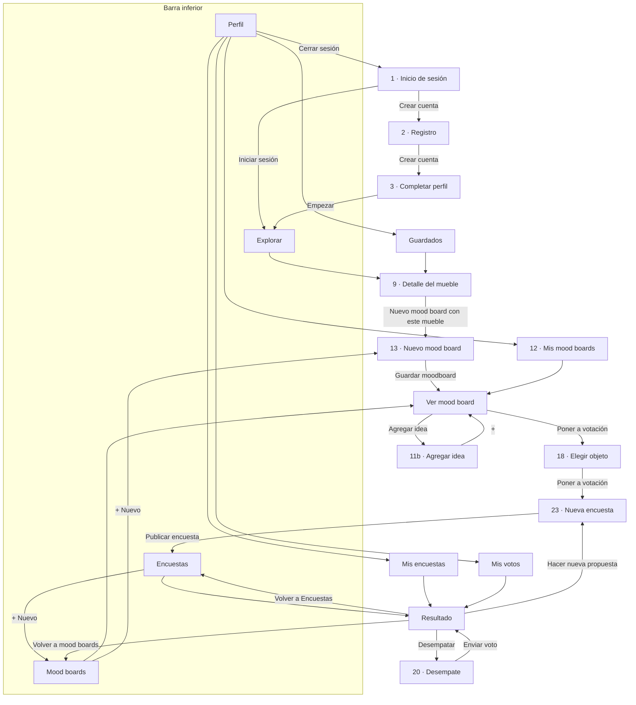

# Guía de Roomies Deco

App para que los roommates de una casa decidan juntos cómo decorar: descubren muebles, arman mood boards y votan qué entra al espacio común.

> **Estado: Fase 3 terminada.** Todas las pantallas están hechas y usan datos de prueba.
> Ya se puede usar la app completa: iniciar sesión, explorar muebles, armar mood boards, crear encuestas y votar.
> Falta la Fase 4: que las encuestas se cierren y se decidan solas, que el desempate termine la votación y que las sugerencias también comparen colores (ver la sección 11).
> Esta guía se completa en cada fase.

---

## Documentos del proyecto

| Archivo | Qué tiene |
|---|---|
| `GUIA.md` | Esta guía: cómo ejecutar y probar la app, carpetas, colores, navegación, datos, componentes y decisiones |
| `FASE-1-propuesta.md` | Propuesta aprobada en la Fase 1: pantallas, navegación, componentes y modelo de datos |
| `NOTAS-FIGMA.md` | Código de cada pantalla y foto del Figma, títulos y botones de cada pantalla, y qué foto usa cada mueble |
| `docs/imagenes/` | Imágenes para la documentación: colores del Figma y pantallas de las fases 2 y 3 |

El historial de las conversaciones con Claude no está en el repositorio, porque el repositorio es público. Se entregó como un archivo aparte.

---

## 1. Cómo ejecutar la app desde VS Code

### Lo que necesitas instalar (una sola vez)

1. **Node.js 22** (22.13 o más reciente) o **Node.js 24**, desde [nodejs.org](https://nodejs.org). El SDK 58 de Expo no funciona con Node 20. Para revisar tu versión escribe `node --version` en una terminal.
2. **Git**, desde [git-scm.com](https://git-scm.com).
3. **Visual Studio Code**.
4. **Expo Go** en el teléfono, desde la App Store o Google Play, actualizada (abre proyectos del SDK 58).

### Descargar el proyecto (una sola vez)

1. Abre VS Code.
2. Presiona `Ctrl + Shift + P` (en Mac, `Cmd + Shift + P`), escribe **Git: Clone** y presiona Enter.
3. Pega la dirección del repositorio y presiona Enter:

   ```
   https://github.com/quijanooluc1a-spec/ColivingApp.git
   ```

4. Elige la carpeta donde quieres guardarlo y, cuando VS Code pregunte, toca **Open** (Abrir).
5. Si VS Code sugiere instalar la extensión **Expo Tools**, acéptala (ayuda con `app.json`).

### Ejecutar la app

1. Abre la terminal de VS Code: menú **Terminal → New Terminal** (o `` Ctrl + ` ``).
2. La primera vez instala las librerías:

   ```bash
   npm install
   ```

3. Arranca el proyecto:

   ```bash
   npx expo start
   ```

4. Para **ver la app**, elige una opción:
   - **En el navegador del computador:** con la terminal seleccionada, presiona la tecla `w`. La app se ve del ancho de un teléfono, en el centro de la ventana. La primera vez que abres cada pantalla puede aparecer "Bundling…" unos segundos mientras se prepara.
   - **En el teléfono:** escanea el código QR que aparece en la terminal. En Android, con la app Expo Go; en iPhone, con la cámara. El teléfono y el computador deben estar en la misma red Wi‑Fi.
   - **En un emulador de Android:** si tienes Android Studio instalado, presiona `a`.

Mientras `npx expo start` está corriendo, cada vez que guardas un archivo la app se actualiza sola. Para detenerlo, presiona `Ctrl + C` en la terminal.

### Traer los cambios nuevos

Cuando haya cambios nuevos en GitHub (por ejemplo, al terminar cada fase), tráelos con:

```bash
git pull
```

Si después de traer cambios aparece un error de librerías, vuelve a correr `npm install`. En la Fase 3 se agregaron librerías nuevas, así que hay que correrlo una vez.

### Si algo no funciona

| Problema | Solución |
|---|---|
| El teléfono no se conecta al escanear el QR (por ejemplo, en la red de la universidad) | Arranca con `npx expo start --tunnel` |
| Expo Go dice que iniciaste sesión en Expo Go pero no en Expo CLI ("not signed in to Expo CLI") | En la terminal de VS Code escribe `npx expo login` y entra con la misma cuenta de Expo Go. Después vuelve a correr `npx expo start`. Mientras tanto puedes usar la versión web (tecla `w`) |
| Expo Go dice que el proyecto usa otra versión del SDK | Actualiza Expo Go desde la tienda |
| Error al arrancar que menciona la versión de Node | Instala Node.js 22 o 24 y vuelve a abrir VS Code |
| `npx` o `node` no se reconocen | Node.js no quedó instalado; reinstálalo y reinicia VS Code |
| Error "Unable to resolve" una librería después de `git pull` | Corre `npm install` y vuelve a arrancar |

---

## 2. Cómo probar la app

### Cuentas de prueba

Las tres viven en la misma casa, "Apartamento", y usan la contraseña `1234`.

| Correo | Persona | Sus mood boards |
|---|---|---|
| `ana@email.com` | Ana Gómez | "Sala acogedora" y "Mi cuarto" (borrador) |
| `mateo@email.com` | Mateo Ruiz | "Sala minimalista" y "Comedor industrial" |
| `valentina@email.com` | Valentina Díaz | "Rincón verde" |

También puedes crear una cuenta nueva con **Crear cuenta**: entra a la misma casa como un roommate más.

Los datos viven mientras la app está abierta. Si recargas la página o cierras la app, vuelven los datos de prueba y hay que iniciar sesión otra vez. Para votar como varias personas, cierra sesión (Perfil → Cerrar sesión) y entra con otra cuenta, sin recargar.

### Recorrido sugerido (unos 5 minutos)

1. **Inicio de sesión:** entra con `ana@email.com` y `1234`.
2. **Explorar:** baja hasta el final (las ideas llegan de 10 en 10), toca el chip **Mesas** y busca "lampara" (funciona con o sin tilde).
3. **Detalle:** toca un mueble y revisa medidas y materiales. Toca **Guardar en moodboard** y elige "Mi cuarto". **Comprar** abre la búsqueda de ese mueble en Homecenter.
4. **Mood boards:** abre "Sala acogedora", toca **Agregar idea** y luego el **+** de un mueble. Vuelves al mood board con el aviso "Idea agregada" y la foto marcada como "Nueva".
5. **Poner a votación:** elige el mueble nuevo, cambia los textos de los botones (por ejemplo, "Sí, pongámoslo / No, busquemos otro"), elige la duración y toca **Publicar encuesta**.
6. **Encuestas:** vota en la "Lámpara de arco". Los números cambian al momento y tu voto queda relleno; lo puedes cambiar.
7. **Terminadas** (más abajo en Encuestas): abre "Mesa de comedor" (ganó el sí), "Lámpara de pie" (no ganó y muestra sugerencias), "Love seat azul" (empate y desempate) y "Planta monstera" (decisión final).
8. **Perfil:** toca Guardados, Votos y Moodboards, prueba los interruptores de notificaciones y cierra sesión.
9. **Nuevo mood board:** en Mood boards toca **+ Nuevo**, elige 4 ideas o más y sube una foto con **+ Fotos**: la paleta toma colores de esa foto. Con menos de 4 ideas se guarda como borrador.

### Las pantallas


---

## 3. Carpetas

Es la misma organización de la plantilla de clase **cafe-app**:

```
ColivingApp/
├── src/app/                 ← pantallas: cada archivo es una pantalla
│   ├── _layout.jsx          ← carga las letras y el contexto, y define la navegación principal (Stack)
│   ├── (tabs)/              ← las 4 pestañas de la barra inferior
│   │   ├── _layout.jsx      ← la barra inferior
│   │   └── explorar.jsx, encuestas.jsx, moodboards.jsx, perfil.jsx
│   └── ...                  ← el resto de pantallas (ver la sección 5)
├── assets/
│   ├── Components/          ← los 21 componentes reutilizables, uno por archivo (sección 7)
│   ├── Contexto/
│   │   └── AppContexto.jsx  ← los datos que comparten todas las pantallas (sección 6)
│   ├── Datos/               ← datos de prueba: casa, usuarios, muebles, mood boards, encuestas y votos
│   ├── Logica/              ← funciones de textos, paleta de colores y votación (sección 8)
│   ├── Servicios/
│   │   └── muebles.jsx      ← entrega los muebles de 10 en 10 (hoy desde Datos; mañana desde una base de datos)
│   ├── Styles/
│   │   ├── Tema.jsx         ← colores, letras, bordes y espacios del Figma
│   │   └── Stylesheet.jsx   ← todos los estilos (StyleSheet.create)
│   └── images/              ← ícono, pantalla de carga y muebles/ (las 21 fotos del Figma)
├── docs/imagenes/           ← imágenes para la documentación
├── app.json                 ← nombre, ícono, colores y permiso para leer fotos
├── package.json             ← librerías que usa el proyecto
└── *.md                     ← documentos del proyecto (ver arriba)
```

---

## 4. Tema: colores y letras del Figma

Todos los valores del diseño están en **un solo archivo**, `assets/Styles/Tema.jsx`. Si el Figma cambia, se cambia ahí y toda la app se actualiza.

### Colores

Los colores de la app son **las 12 variables de color del Figma**, con los mismos valores. De la plantilla cafe-app solo se tomó la forma de programar; sus colores (`#4B2A19` y `#F1E5D1`) no se usan en ningún archivo.

| En `Tema.jsx` | Variable del Figma | Color | Dónde se usa |
|---|---|---|---|
| `fondo` | `color/background` | `#FAF5EE` crema | Fondo de todas las pantallas |
| `superficie` | `color/surface` | `#FFFFFF` blanco | Tarjetas, cajas de texto, barra inferior |
| `borde` | `color/border` | `#E8DED2` beige | Bordes, divisores, fondo de las barras de votos |
| `texto` | `color/text` | `#2B2420` café oscuro | Texto principal |
| `textoSuave` | `color/text-muted` | `#8A817A` gris cálido | Etiquetas, subtítulos, precios |
| `principal` | `color/primary` | `#D9653B` terracota | Botones, chips activos, pestaña activa, precio del detalle |
| `sobrePrincipal` | `color/on-primary` | `#FFFFFF` blanco | Texto encima del terracota |
| `principalSuave` | `color/primary-soft` | `#F6DDD0` rosado | Avatar de Ana, sugerencia elegida, íconos del perfil |
| `verdeSuave` | `color/secondary-soft` | `#DDE7DD` verde claro | Avatar de Mateo, chip de vibra, avisos de éxito |
| `amarilloSuave` | `color/accent-soft` | `#FCEBC6` amarillo | Avatar de Valentina, aviso "Ganó el «No»" |
| `meGusta` | `color/like` | `#3E8E5A` verde | Botón del sí, conteos, barra positiva, interruptores |
| `noMeGusta` | `color/dislike` | `#C8453B` rojo | Botón del no, barra negativa |

En la Fase 3 ya se ven todos: el amarillo, los verdes y el rosado aparecen en los avatares, los avisos, los chips de vibra y los botones de voto. Los tonos tierra llegan con las fotos de los muebles.


### Letras, bordes y espacios

| Grupo | Qué tiene | Ejemplo |
|---|---|---|
| `fuentes` | Los nombres de las 4 letras | `fuentes.poppinsBold` |
| `letras` | Los 7 estilos de texto del Figma: letra, tamaño y alto de línea | `letras.titulo` = Poppins Bold 22 |
| `bordes` | Bordes redondeados: 8, 12, 16, 24 y 999 | `bordes.normal` = 16 |
| `espacios` | Márgenes y separaciones | `espacios.normal` = 16 (margen a los lados) |
| `medidas` | Ancho máximo de la app en el computador | `medidas.anchoMaximo` = 480 |

`assets/Styles/Stylesheet.jsx` arma los estilos con esos valores, agrupados como en la plantilla:

- **Generales:** `general` (pantalla, contenido, títulos, textos, grupos).
- **Uno por componente:** `boton`, `chip`, `encabezado`, `barraInferior`, `tarjetaMueble`, `tarjetaEncuesta`, `botonVoto`, `aviso` y los demás.
- **Uno por pantalla:** `inicio`, `detalle`, `hoja`, `moodboards`, `moodboard`, `nuevoMoodboard`, `elegir`, `nuevaEncuesta`, `encuestas`, `resultado` y `perfil`.

Se usan así:

```jsx
import { general } from "../../assets/Styles/Stylesheet";

<Text style={general.titulo}>Mood boards</Text>
```

En `Stylesheet.jsx` vas a ver `...letras.titulo`. Los tres puntos copian dentro del estilo la letra, el tamaño y el alto de línea que están en `Tema.jsx`.

**Letras:** Poppins (títulos) e Inter (textos), de `@expo-google-fonts`. Se cargan en `src/app/_layout.jsx` con `useFonts`, y mientras cargan no se muestra nada.

**Íconos:** [Lucide](https://lucide.dev) (`lucide-react-native`), los mismos del Figma:

| Dónde | Ícono |
|---|---|
| Pestañas Explorar, Encuestas, Mood boards y Perfil | `Compass`, `Folder`, `LayoutGrid`, `User` |
| Botón volver | `ArrowLeft` |
| Logo del inicio de sesión | `House` |
| Buscador | `Search` |
| "Disponible en Homecenter" | `Store` |
| Agregar idea, "+ Fotos", "Nuevo mood board" | `Plus` |
| Idea elegida o ya agregada | `Check` |
| Botones de voto | `ThumbsUp`, `ThumbsDown` |
| Avisos de éxito | `CircleCheck` |
| Filas del perfil | `Folder`, `ThumbsUp`, `Bell`, `Vote`, `Trophy` y la flecha `ChevronRight` |

---

## 5. Navegación

La app usa **Expo Router**: cada archivo dentro de `src/app` es una pantalla y su ruta es el nombre del archivo. Por ejemplo, `src/app/registro.jsx` es la pantalla `/registro`.

- **`_layout.jsx`** define cómo se pasa de una pantalla a otra. El de `src/app` es un **Stack**: cada pantalla nueva se pone encima de la anterior y se puede volver. El de `(tabs)` es la **barra inferior**.
- **Los paréntesis** en `(tabs)` agrupan pantallas sin cambiar la ruta: `(tabs)/explorar.jsx` es `/explorar`.
- **`[id]`** en el nombre significa que la pantalla recibe un dato. Por ejemplo, `/mueble/m1` abre `mueble/[id].jsx` con `id = "m1"`. La pantalla lo lee así:

  ```jsx
  const { id } = useLocalSearchParams();
  ```

- **Datos extra en la ruta**, después de `?`: `/encuesta/nueva?mueble=m10&moodboard=mb1` le dice a Nueva encuesta qué mueble y qué mood board usar. Se leen igual, con `useLocalSearchParams()`.

### Pantallas

| Archivo (`src/app/…`) | Ruta | Pantalla del Figma |
|---|---|---|
| `index.jsx` | `/` | 1 · Inicio de sesión (la primera pantalla) |
| `registro.jsx` | `/registro` | 2 · Registro |
| `completar-perfil.jsx` | `/completar-perfil` | 3 · Completar perfil |
| `(tabs)/explorar.jsx` | `/explorar` | 4, 6, 7, 8 · Explorar |
| `(tabs)/encuestas.jsx` | `/encuestas` | 22 · Encuestas |
| `(tabs)/moodboards.jsx` | `/moodboards` | 10, 10b · Mood boards |
| `(tabs)/perfil.jsx` | `/perfil` | 26 · Perfil |
| `mueble/[id].jsx` | `/mueble/m1` | 9 · Detalle del mueble, con la hoja "Guardar en un mood board" |
| `moodboard/nuevo.jsx` | `/moodboard/nuevo` | 13 · Nuevo mood board |
| `moodboard/[id].jsx` | `/moodboard/mb1` | 11, 14, 15, 17 · Ver un mood board |
| `agregar-idea/[id].jsx` | `/agregar-idea/mb1` | 11b · Agregar idea |
| `elegir-objeto/[id].jsx` | `/elegir-objeto/mb1` | 18 · Poner a votación |
| `encuesta/nueva.jsx` | `/encuesta/nueva` | 23 · Nueva encuesta |
| `encuesta/[id].jsx` | `/encuesta/e1` | 24, 25, 25b, 19, 21 · Resultado (y la encuesta activa) |
| `desempate/[id].jsx` | `/desempate/e6` | 20 · Votación de desempate |
| `mis-moodboards.jsx` | `/mis-moodboards` | 12 · Mis mood boards |
| `guardados.jsx` | `/guardados` | (nueva) Muebles guardados |
| `mis-encuestas.jsx` | `/mis-encuestas` | (nueva) Encuestas que creé |
| `mis-votos.jsx` | `/mis-votos` | (nueva) Votos que di |

`encuesta/[id].jsx` muestra una de cinco versiones según cómo va la encuesta:

| Cómo va | Lo que se ve | Botones |
|---|---|---|
| Activa | Pregunta, votos, "cierra en …" y los botones para votar o cambiar el voto | Volver a Encuestas |
| Ganó el sí (24) | Foto, barras de votos y aviso verde | Comprar mueble · Volver a Encuestas |
| No ganó (25, 25b) | Barras, aviso amarillo y 3 sugerencias para elegir | Hacer nueva propuesta · Volver a Encuestas |
| Empate (19) | "¡Empate 1 – 1!", barras y cómo funciona el desempate | Desempatar de forma anónima · Volver a mood boards |
| Decisión final (21) | Resultado del desempate y cómo se llegó a él | Ir a Encuestas · Volver a mood boards |

### Flujo entre pantallas



### Cómo se cambia de pantalla

Todas las funciones vienen de `router` (`import { router } from "expo-router"`):

| Función | Qué hace | Dónde se usa |
|---|---|---|
| `router.push("/mueble/m1")` | Abre una pantalla encima de la actual; se puede volver | Casi todos los botones y tarjetas |
| `router.back()` | Vuelve a la pantalla anterior | Flecha del `Encabezado`, Cancelar, Enviar voto de desempate |
| `router.replace("/explorar")` | Cambia la pantalla actual por otra; no se puede volver a la anterior | Iniciar sesión, Cerrar sesión, Guardar moodboard |
| `router.navigate("/moodboards")` | Va a una pantalla; si es una pestaña, cambia de pestaña | "+ Nuevo" de Encuestas |
| `router.dismissAll()` | Cierra todas las pantallas de encima hasta la primera | Completar perfil → Empezar |
| `router.dismissTo("/encuestas")` | Cierra pantallas hasta llegar a esa ruta | Publicar encuesta, Volver a Encuestas, Volver a mood boards, "+" de Agregar idea |

Ejemplos:

- Al tocar **Empezar** en Completar perfil se usan `dismissAll()` y después `replace("/explorar")`. Así el botón "atrás" no vuelve al registro.
- Al tocar **+** en Agregar idea se usa `dismissTo("/moodboard/mb1?aviso=idea&nueva=i123")`. La pantalla del mood board lee `aviso` para mostrar "Idea agregada" y `nueva` para marcar la foto con la etiqueta "Nueva".

**Si nadie ha iniciado sesión.** En `src/app/_layout.jsx` hay un componente `Guardian`: si no hay sesión y la pantalla no es el inicio de sesión ni el registro, vuelve a `/`. Pasa, por ejemplo, al recargar la página en el navegador, porque los datos solo viven mientras la app está abierta.

---

## 6. Datos de prueba y cómo viajan

```
assets/Datos   →   assets/Servicios   →   AppContexto (useState)   →   pantallas (useContext)
(datos de prueba)   (funciones)           (datos compartidos)          (lo que se ve)
```

- **`assets/Datos`** son listas de objetos, como las filas de una tabla. El día que se conecte una base de datos (por ejemplo Supabase, como en cafe-app), cada archivo se convierte en una tabla.
- **`assets/Servicios/muebles.jsx`** entrega los muebles: `obtenerMuebles(pagina, categoria, busqueda)` espera 0,4 segundos, como si los datos llegaran de internet, y devuelve 10. Al conectar una base de datos, este es el archivo que cambia; el comentario de la función muestra cómo quedaría.
- **`assets/Contexto/AppContexto.jsx`** es una caja compartida. Guarda con `useState` quién inició sesión, los usuarios, los mood boards, las encuestas y los votos, y tiene las funciones que los cambian.
- **Las pantallas** la usan así:

  ```jsx
  const { usuario, encuestas, votar } = useContext(AppContexto);
  ```

### Lo que hay en `AppContexto`

**Datos:** `casa`, `usuario` (quién inició sesión, o `null`), `usuarios`, `roommates` (los de la casa), `moodboards`, `moodboardsDeLaCasa` (los compartidos de la casa más todos los míos), `encuestas` y `votos`.

**Funciones:**

| Función | Qué hace | Dónde se usa |
|---|---|---|
| `iniciarSesion(correo, contrasena)` | Si el correo y la contraseña son de alguien, inicia la sesión y devuelve `true` | Inicio de sesión |
| `registrarse(nombre, correo, contrasena)` | Crea la cuenta en la casa "Apartamento". Devuelve `""` si salió bien o un mensaje de error | Registro |
| `completarPerfil(nombre, convive, vibras)` | Guarda el nombre, con quién vive y su vibra | Completar perfil |
| `cerrarSesion()` | Cierra la sesión | Perfil |
| `cambiarNotificacion(clave, valor)` | Prende o apaga un interruptor: `activas`, `nuevas` o `resultados` | Perfil |
| `guardarMueble(idMueble)` | Agrega el mueble a Guardados | Detalle (hoja de guardar) |
| `crearMoodboard(nombre, ideas, vibras, compartido)` | Crea un mood board y devuelve su id | Nuevo mood board |
| `agregarIdea(idMoodboard, idea)` | Agrega un mueble o una foto al mood board y devuelve el id de la idea | Agregar idea, Detalle |
| `crearEncuesta(idMueble, idMoodboard, pregunta, textoSi, textoNo, horas)` | Crea una encuesta activa que cierra en esas horas | Nueva encuesta |
| `votar(idEncuesta, valor, ronda)` | Guarda el voto (`"si"` o `"no"`). Si la persona ya había votado en esa ronda, cambia su voto | Encuestas, Encuesta, Desempate |

### Modelo de datos

| Archivo | Campos |
|---|---|
| `casa.jsx` | `id`, `nombre` |
| `usuarios.jsx` | `id`, `nombre`, `correo`, `contrasena`, `iniciales`, `colorAvatar`, `convive`, `vibras`, `id_casa`, `guardados` (ids de muebles), `notificaciones` (`{ activas, nuevas, resultados }`) |
| `muebles.jsx` | `id`, `nombre`, `categoria`, `precio`, `imagen`, `proporcion` (alto ÷ ancho de la foto), `tienda`, `largo`, `ancho`, `alto`, `color`, `materiales`, `estilo`, `descripcion`, `colores` (los 5 colores principales de la foto) |
| `moodboards.jsx` | `id`, `nombre`, `id_dueno`, `ideas` (cada una es `{ id, id_mueble }` o `{ id, foto, colores }`), `vibras`, `descripcion`, `compartido` (`false` = borrador) |
| `encuestas.jsx` | `id`, `id_mueble`, `id_moodboard`, `id_creador`, `pregunta`, `texto_si`, `texto_no`, `creada`, `cierra`, `estado` (`"activa"`, `"aprobada"`, `"rechazada"` o `"empate"`), `ronda` (1 normal, 2 desempate) |
| `votos.jsx` | `id`, `id_encuesta`, `id_usuario`, `ronda`, `valor` (`"si"` o `"no"`) |
| `opciones.jsx` | Listas fijas: categorías, vibras, con quién vives, duraciones de una encuesta y textos de los botones de voto |

Cambios frente a la propuesta de la Fase 1:

- La casa no guarda la lista de integrantes: quién vive ahí se sabe por el `id_casa` de cada usuario. Así el dato no está en dos lugares.
- La encuesta guarda el mueble (`id_mueble`) en vez de la idea, y la hora de cierre es un número (milisegundos, como `Date.now()`). Así es fácil calcular "cierra en 4 h".
- El mood board no guarda sus colores: se calculan con sus ideas cada vez, y por eso cambian al agregar una idea.
- El mueble no tiene `url_tienda`: el botón Comprar arma la búsqueda en Homecenter con el nombre del mueble.

### Lo que traen los datos de prueba

- 1 casa ("Apartamento") con 3 roommates.
- 21 muebles con las fotos del Figma, en 6 categorías: Sofás, Mesas, Lámparas, Sillas, Estantes y Plantas.
- 5 mood boards: "Sala acogedora" y "Mi cuarto" (borrador) de Ana, "Sala minimalista" y "Comedor industrial" de Mateo, y "Rincón verde" de Valentina.
- 7 encuestas, una por cada estado que muestra el Figma, y sus votos:

| Encuesta | Mueble | Estado | Sirve para ver |
|---|---|---|---|
| `e1` | Sofá 3 puestos | Activa, 2 – 0 (falta Valentina) | Votar desde la lista |
| `e2` | Lámpara de arco | Activa, 1 – 1 (falta Ana) | Votar desde la lista |
| `e3` | Silla de comedor | Activa, 1 – 0 (faltan Ana y Mateo) | Votar desde la lista |
| `e4` | Mesa de comedor | Ganó el sí, 2 – 1 | 24 · Resultado con "Comprar mueble" |
| `e5` | Lámpara de pie | No ganó, 1 – 2 | 25 · Resultado con sugerencias |
| `e6` | Love seat azul | Empate, 1 – 1 | 19 · Empate y 20 · Desempate |
| `e7` | Planta monstera | Empate 1 – 1 y desempate 2 – 1 | 21 · Decisión final |

---

## 7. Componentes

Están en `assets/Components`. Cada uno es una función con sus props entre llaves y `export default` al final, como `ProductoItem` en la plantilla. Son los 20 de la propuesta más `Catalogo`, que junta los chips y la grilla para usarlos en Explorar y en Agregar idea.

| Componente | Para qué sirve | Props |
|---|---|---|
| `Boton` | Botón grande naranja, o blanco con borde naranja | `texto`, `alPresionar`, `tipo` (`"principal"` o `"secundario"`), `deshabilitado` |
| `Chip` | Botón pequeño redondeado: filtros, vibras, duraciones y "+ Nuevo". Sin `alPresionar` solo se muestra | `texto`, `seleccionado`, `alPresionar` |
| `Encabezado` | Título de la pantalla, con o sin flecha para volver | `titulo`, `subtitulo`, `conVolver`, `botonDerecha` |
| `EstadoVacio` | Mensaje cuando una lista está vacía | `titulo`, `mensaje` |
| `CampoTexto` | Etiqueta con su caja de texto | `etiqueta`, `valor`, `alCambiar`, `placeholder`, `esContrasena`, `esCorreo` |
| `Buscador` | Caja de búsqueda con lupa | `valor`, `alCambiar` |
| `TarjetaMueble` | Foto, nombre y precio. En Agregar idea tiene el botón "+" | `mueble`, `ancho`, `alPresionar`, `mostrarMas`, `alAgregar`, `agregado` |
| `GrillaMuebles` | Dos columnas de tarjetas, cada una del alto de su foto, como en el Figma | `muebles`, `alPresionarMueble`, `mostrarMas`, `alAgregar`, `agregados` |
| `Catalogo` | Chips de categorías y grilla que carga 10 ideas más al bajar | `busqueda`, `alPresionarMueble`, `mostrarMas`, `alAgregar`, `agregados` |
| `TarjetaTienda` | "Disponible en Homecenter" | `tienda`, `alPresionar` |
| `TarjetaMoodboard` | Collage pequeño con nombre y subtítulo, o la tarjeta punteada "Nuevo mood board" | `titulo`, `subtitulo`, `fotos`, `ancho`, `alPresionar`, `esNuevo` |
| `Collage` | Fotos del mood board: una grande con dos pequeñas, y debajo filas de tres. Marca la idea nueva | `fotos`, `ancho`, `idNueva` |
| `Paleta` | Círculos de colores | `colores` |
| `BotonVoto` | Botón verde (sí) o rojo (no), relleno cuando es tu voto | `texto`, `tipo` (`"si"` o `"no"`), `seleccionado`, `alPresionar` |
| `TarjetaEncuesta` | Encuesta en la lista: foto, datos, conteo y botones para votar | `encuesta`, `mueble`, `creador`, `conteo`, `miVoto`, `alVotar`, `alAbrir` |
| `BarraResultado` | Barra con los votos de una opción | `texto`, `votos`, `total`, `tipo` |
| `Aviso` | Mensaje de color: verde, amarillo o neutro | `texto`, `tipo` (`"exito"`, `"alerta"` o `"info"`), `conIcono` |
| `Avatar` | Círculo con las iniciales | `iniciales`, `tamano`, `color` |
| `TarjetaOpcion` | Fila con foto, título, subtítulo y círculo para elegir (sugerencias, desempate, hoja de guardar) | `foto`, `titulo`, `subtitulo`, `seleccionado`, `alPresionar`, `tamanoFoto` |
| `TarjetaEstadistica` | Número grande con su etiqueta (perfil y medidas del mueble) | `numero`, `etiqueta`, `alPresionar` |
| `FilaAjuste` | Fila del perfil con ícono y flecha o interruptor | `Icono`, `texto`, `alPresionar`, `derecha` |

Ejemplo de uso, tomado de `src/app/(tabs)/encuestas.jsx`:

```jsx
<TarjetaEncuesta
  key={encuesta.id}
  encuesta={encuesta}
  mueble={buscarMueble(encuesta.id_mueble)}
  creador={nombreDe(encuesta.id_creador)}
  conteo={contarVotos(votos, encuesta.id, encuesta.ronda)}
  miVoto={votoDe(votos, encuesta.id, usuario.id, encuesta.ronda)}
  alVotar={function (valor) {
    votar(encuesta.id, valor);
  }}
  alAbrir={function () {
    abrir(encuesta);
  }}
/>
```

Los botones usan `TouchableOpacity`, que se aclara un poco al tocarlo.

---

## 8. Lógica (`assets/Logica`)

Son funciones que no dibujan nada: reciben datos y devuelven un resultado. Así las pantallas quedan más cortas.

| Archivo | Funciones |
|---|---|
| `textos.jsx` | `formatearPrecio(890000)` → "$ 890.000" · `primerNombre("Ana Gómez")` → "Ana" · `unirNombres(["Ana", "Mateo", "Valentina"])` → "Ana, Mateo y Valentina" · `describirVibra(["Cálido", "Natural"])` → "Cálida y natural" · `textoVotos(1)` → "1 voto" · `textoIdeas(1)` → "1 idea" · `tiempoRestante(cierra)` → "cierra en 4 h" · `sinTildes("Lámpara")` → "lampara" (para buscar con o sin tilde) |
| `paleta.jsx` | `paletaDeIdeas(ideas)`, `coloresDeFoto(uri)` y `queCombina(colores)` |
| `votacion.jsx` | `contarVotos(votos, idEncuesta, ronda)` → `{ si, no, total }` · `votoDe(...)` → `"si"`, `"no"` o `null` · `resumenEncuesta(encuesta, votos)` → "Ganó «Me gusta» · 2 – 1" · `sugerirMuebles(...)` |

### La paleta de un mood board

`paletaDeIdeas` toma el color principal de cada idea, después el segundo, y se queda con 5 colores, saltándose los que son casi iguales a uno ya elegido.

Los muebles de prueba ya traen sus colores. Para una foto subida con "+ Fotos", `coloresDeFoto` los saca así:

1. Achica la foto a 16 × 16 píxeles (`expo-image-manipulator`).
2. Lee el color de cada píxel (`jpeg-js`).
3. Redondea los colores para juntar los parecidos y cuenta cuántas veces sale cada uno.
4. Se queda con los 5 que más se repiten.

### ¿Qué combina?

`queCombina` usa la paleta:

- **Paredes:** el color más claro.
- **Pisos:** el más oscuro.
- **Muebles:** el más vivo de los que quedan.
- **Luz:** cálida si la paleta tiene más rojo que azul; si no, fría.

### Sugerencias cuando una encuesta no gana

`sugerirMuebles` busca los muebles de los mood boards de la casa, menos el que perdió. Da 10 puntos si es de la misma categoría y 1 punto por cada roommate que lo tiene en sus mood boards. Muestra los 3 mejores con "Coincide con Ana y Mateo". En la Fase 4 también va a comparar los colores.

---

## 9. Decisiones tomadas donde el Figma no era explícito

### Fase 2

| Tema | Decisión |
|---|---|
| Versión de Expo | **SDK 58**, la más reciente. La plantilla de clase usa el 57, pero la app Expo Go de la tienda abre el SDK más reciente, que es el 58. |
| Nombre de la app | **Roomies Deco**. Se cambia en `app.json` (`name`). |
| Ícono y pantalla de carga | Se hicieron con el logo del login del Figma: la casa blanca sobre el cuadrado terracota. |
| Modo oscuro | No hay: el Figma solo tiene modo claro (`"userInterfaceStyle": "light"` en `app.json`). |
| "+ Nuevo" en Encuestas | Lleva a la pestaña Mood boards, porque para crear una encuesta hay que elegir un objeto de un mood board (aprobado el 5 nov 2026). Está en la fila de los avatares, como en el Figma. |
| Barra inferior | Se usa `Tabs` de `expo-router/js-tabs` y no `NativeTabs`. La barra nativa no deja poner los íconos de Lucide ni el texto activo más grande, como en el Figma. |
| Relleno de las pestañas | Se quita el relleno lateral que pone la librería (`tabBarButton` en `(tabs)/_layout.jsx`). Sin ese cambio, "Mood boards" no cabía en una línea. |
| Título de "Agregar idea" | En el Figma esa pantalla tiene flecha y título de 28. Se usa 22, como en las demás pantallas con flecha. |
| Espacio de arriba | Cada pantalla usa `SafeAreaView` para no quedar debajo de la hora y la batería. Las pestañas usan `edges={["top"]}` porque abajo ya está la barra. |

### Fase 3

| Tema | Decisión |
|---|---|
| Botón del detalle del mueble | **"Guardar en moodboard"** (el Figma dice "Guardar en Encuestas"). Abre una hoja desde abajo para elegir uno de tus mood boards, crear uno nuevo con ese mueble o solo guardarlo en Guardados. |
| Comprar | Abre en el navegador la búsqueda del mueble en Homecenter, porque los datos de prueba no tienen enlaces a productos reales. |
| Medidas, color y materiales | El Figma no los tiene. Se muestran en tres recuadros (Largo, Ancho, Alto) y en chips. |
| Nombres repetidos en el Figma | Había dos "Lámpara de pie": la de arco negro se llama **Lámpara de arco**. La foto de la mesa de comedor se llamaba "Mesa auxiliar" con el precio de la mesa auxiliar: se llama **Mesa de comedor** y cuesta $ 690.000. El estante blanco se llamaba "Estante de madera": se llama **Estante blanco**. El estante de madera y la planta monstera no tenían precio; se les puso uno. |
| Cantidad de muebles | **21**, las fotos que tiene el Figma. Para llegar a unos 30 faltan fotos de camas, clósets y tocadores. |
| Categorías de Explorar | Salen de los datos: solo hay chip para las categorías que tienen muebles. |
| "Cargar más ideas" | Las ideas llegan solas al bajar, de 10 en 10. El botón solo aparece si falla la carga. |
| Mood board con pocas ideas | Se piden 4 ideas o más. Con menos se guarda como **borrador**: solo lo ve su dueño y en "Mis moodboards" dice "Borrador". |
| Subtítulos de los mood boards | En "Todos": dueño y vibra ("Tú · Cálida y natural"). En "Mis moodboards": "Vibra: …" o "Borrador". |
| Paleta | Se calcula con las fotos del mood board; la del Figma era un ejemplo. Cambia al agregar ideas o subir fotos. |
| Opciones de la encuesta | Dos opciones con textos editables, sin "+ Agregar opción". Dos chips llenan los textos rápido: "Me gusta / No me gusta" y "Sí, pongámoslo / No, busquemos otro". |
| Botón "Encuesta" en la lista | Pasó de la fila de los votos a la esquina de arriba de la tarjeta, para que los botones de voto tengan todo el ancho y quepan textos largos como "No, busquemos otro". |
| Encuestas terminadas | Debajo de las activas hay una sección **Terminadas** con el resultado de cada una. El Figma solo muestra encuestas activas. |
| Detalle de una encuesta activa | El Figma no lo tiene. Muestra la pregunta, cuántos votaron, cuánto falta para que cierre y los botones para votar o cambiar el voto. |
| Texto del empate | "Si después de 2 rondas sigue el empate, el mueble no se pone", la regla de desempate de la propuesta. |
| "Olvidé mi contraseña" | Muestra un aviso: todavía no hay servidor para recuperar contraseñas. |
| Cuentas de prueba | El inicio de sesión muestra los correos de prueba y la contraseña. |
| Notificaciones | El interruptor del Figma más "Nuevas encuestas" y "Resultados". Solo se guarda la preferencia; todavía no se envían notificaciones. |
| Ancho en el computador | En la versión web la app se queda del ancho de un teléfono (máximo 480 px), en el centro de la ventana. |
| Permiso de fotos | `app.json` declara el permiso para leer fotos (para "+ Fotos") y quita los de cámara y micrófono, que la app no usa. |

---

## 10. Cómo se revisó la Fase 3

- **ESLint** (el revisor de código): sin errores en `src` ni en `assets`.
- **Compilación para Android e iOS** (`npx expo export`): sin errores.
- **Recorrido automático en el navegador**, al tamaño de un teléfono (390 × 844): 41 pasos que usan la app como una persona, desde un inicio de sesión con la contraseña equivocada hasta crear una cuenta nueva. Incluye buscar, filtrar, bajar hasta cargar las 21 ideas, guardar en un mood board, agregar una idea, crear y publicar una encuesta, votar, ver los cinco tipos de resultado, desempatar, subir una foto y recargar la página sin sesión. Terminó sin errores ni advertencias en la consola.
- **Comparación con el Figma**: 10 pantallas lado a lado. Las diferencias son las de la sección 9. Además, en el navegador todo queda un poco más arriba, porque no hay barra de hora y batería.

---

## 11. Lo que sigue

- **Fase 4: lógica de votación** (sección 7 de la propuesta):
  - Cerrar las encuestas cuando votan todos o cuando se acaba el tiempo, y que quien la creó pueda cerrarla antes.
  - Contar los votos al cerrar: ganó el sí, no ganó o empate.
  - Desempate completo. Hoy el voto de desempate se guarda, pero la encuesta sigue en "empate". En la Fase 4 la segunda ronda decide, y si sigue el empate el mueble no se pone.
  - Sugerencias que también comparan los colores.
- **Fase 5:** revisión final y esta guía completa: votación paso a paso y cómo conectar un backend real.
