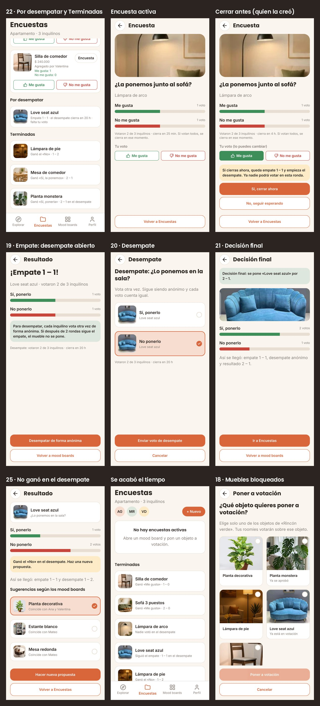
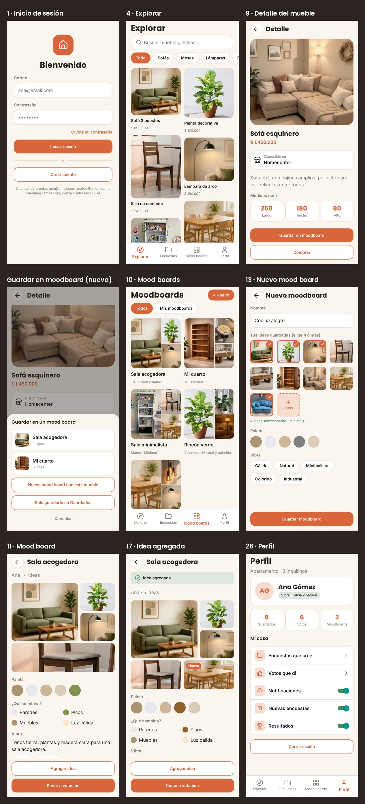
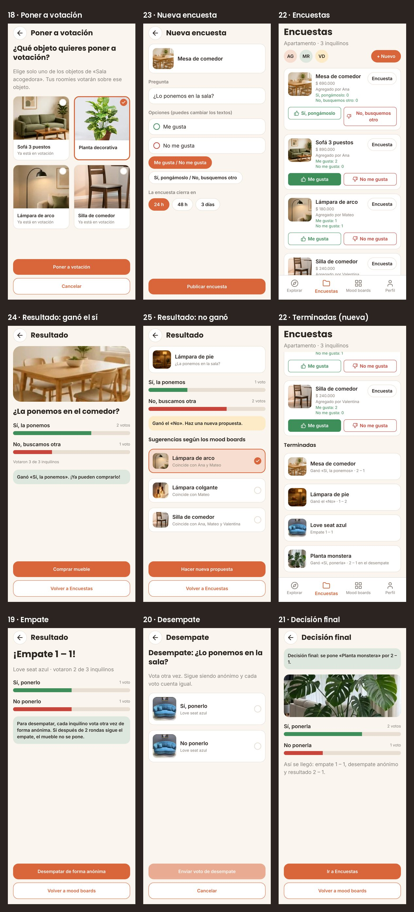
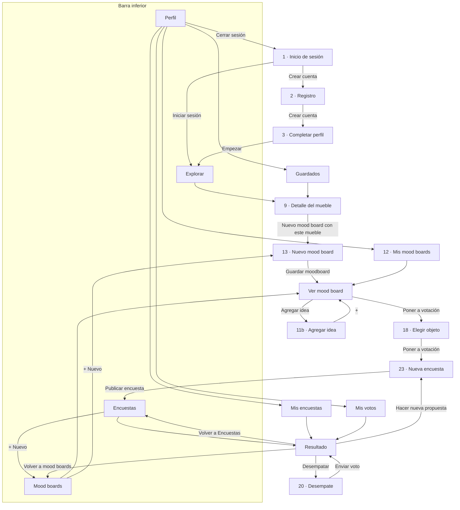
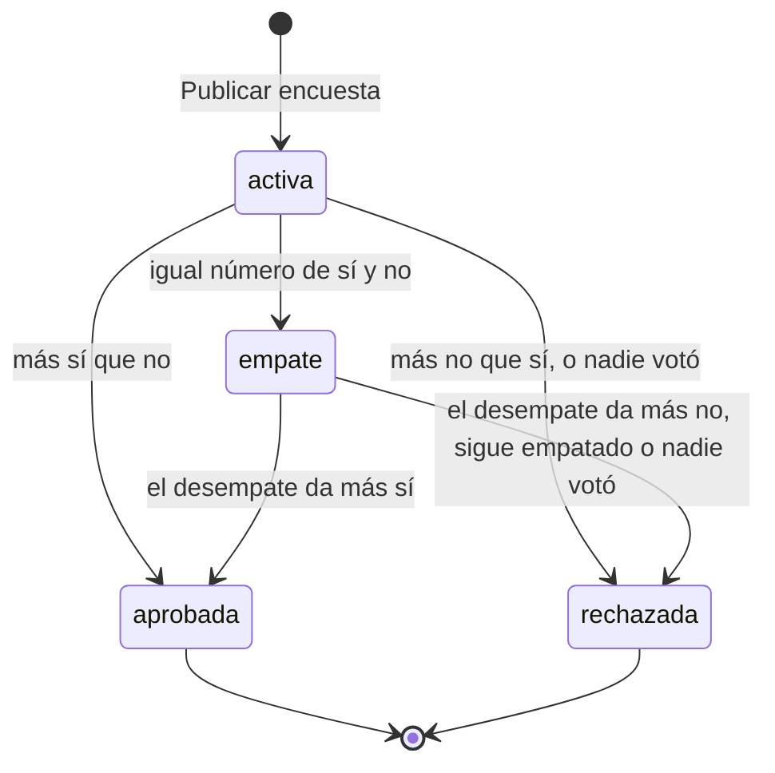
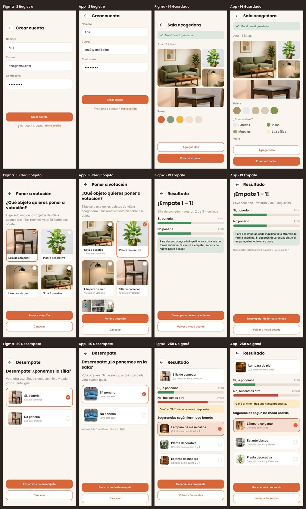

# Guía de Roomies Deco

App para que los roommates de una casa decidan juntos cómo decorar: descubren muebles, arman mood boards y votan qué entra al espacio común.

> **Estado: Fase 5 terminada. El proyecto está completo.**
> Se puede iniciar sesión, explorar muebles, armar mood boards, crear encuestas y votar. Las encuestas se cierran solas (cuando votan todos o cuando se acaba el tiempo), se cuentan, se desempatan y, si un mueble no gana, la app sugiere otros (sección 9).
> La app funciona con los datos de prueba o con una base de datos real en **Supabase**. Para conectarla hay una guía paso a paso: [`GUIA-SUPABASE.md`](GUIA-SUPABASE.md).

---

## Documentos del proyecto

| Archivo | Qué tiene |
|---|---|
| `GUIA.md` | Esta guía: cómo ejecutar y probar la app, carpetas, colores, navegación, datos, componentes y decisiones |
| `FASE-1-propuesta.md` | Propuesta aprobada en la Fase 1: pantallas, navegación, componentes y modelo de datos |
| `GUIA-SUPABASE.md` | Cómo conectar la app a una base de datos en Supabase, paso a paso, para programadores junior |
| `supabase/` | Los 5 archivos SQL de la base de datos (tablas, seguridad, fotos, catálogo y datos de prueba) |
| `.env.ejemplo` | La plantilla del archivo `.env.local`, que tiene la dirección y la clave de Supabase |
| `NOTAS-FIGMA.md` | Código de cada pantalla y foto del Figma, títulos y botones de cada pantalla, qué foto usa cada mueble y la revisión final |
| `docs/imagenes/` | Imágenes para la documentación: colores del Figma, pantallas de las fases 2, 3 y 4, y la comparación final con el Figma |

El historial de las conversaciones con Claude no está en el repositorio, porque el repositorio es público. Se entregó como un archivo aparte.

---

## 1. Cómo ejecutar la app desde VS Code

### Lo que necesitas instalar (una sola vez)

1. **Node.js 22** (22.13 o más reciente) o **Node.js 24**, desde [nodejs.org](https://nodejs.org). El SDK 58 de Expo no funciona con Node 20. Para revisar tu versión escribe `node --version` en una terminal.
2. **Git**, desde [git-scm.com](https://git-scm.com).
3. **Visual Studio Code**.
4. **Expo Go** en el teléfono, desde la App Store o Google Play, actualizada (abre proyectos del SDK 58).

### Descargar el proyecto (una sola vez)

1. Abre VS Code.
2. Presiona `Ctrl + Shift + P` (en Mac, `Cmd + Shift + P`), escribe **Git: Clone** y presiona Enter.
3. Pega la dirección del repositorio y presiona Enter:

   ```
   https://github.com/quijanooluc1a-spec/ColivingApp.git
   ```

4. Elige la carpeta donde quieres guardarlo y, cuando VS Code pregunte, toca **Open** (Abrir).
5. Si VS Code sugiere instalar la extensión **Expo Tools**, acéptala (ayuda con `app.json`).

### Ejecutar la app

1. Abre la terminal de VS Code: menú **Terminal → New Terminal** (o `` Ctrl + ` ``).
2. La primera vez instala las librerías:

   ```bash
   npm install
   ```

3. Arranca el proyecto:

   ```bash
   npx expo start
   ```

4. Para **ver la app**, elige una opción:
   - **En el navegador del computador:** con la terminal seleccionada, presiona la tecla `w`. La app se ve del ancho de un teléfono, en el centro de la ventana. La primera vez que abres cada pantalla puede aparecer "Bundling…" unos segundos mientras se prepara.
   - **En el teléfono:** escanea el código QR que aparece en la terminal. En Android, con la app Expo Go; en iPhone, con la cámara. El teléfono y el computador deben estar en la misma red Wi‑Fi.
   - **En un emulador de Android:** si tienes Android Studio instalado, presiona `a`.

Mientras `npx expo start` está corriendo, cada vez que guardas un archivo la app se actualiza sola. Para detenerlo, presiona `Ctrl + C` en la terminal.

### Traer los cambios nuevos

Cuando haya cambios nuevos en GitHub (por ejemplo, al terminar cada fase), tráelos con:

```bash
git pull
```

Si después de traer cambios aparece un error de librerías, vuelve a correr `npm install`. En las fases 3 y 5 se agregaron librerías nuevas, así que hay que correrlo una vez.

### Si algo no funciona

| Problema | Solución |
|---|---|
| El teléfono no se conecta al escanear el QR (por ejemplo, en la red de la universidad) | Arranca con `npx expo start --tunnel` |
| Expo Go dice que iniciaste sesión en Expo Go pero no en Expo CLI ("not signed in to Expo CLI") | En la terminal de VS Code escribe `npx expo login` y entra con la misma cuenta de Expo Go. Después vuelve a correr `npx expo start`. Mientras tanto puedes usar la versión web (tecla `w`) |
| Expo Go dice que el proyecto usa otra versión del SDK | Actualiza Expo Go desde la tienda |
| Error al arrancar que menciona la versión de Node | Instala Node.js 22 o 24 y vuelve a abrir VS Code |
| `npx` o `node` no se reconocen | Node.js no quedó instalado; reinstálalo y reinicia VS Code |
| Error "Unable to resolve" una librería después de `git pull` | Corre `npm install` y vuelve a arrancar |

---

## 2. Cómo probar la app

### Cuentas de prueba

Las tres viven en la misma casa, "Apartamento", y usan la contraseña `1234`. Con Supabase, las cuentas de prueba usan `123456`, porque Supabase pide al menos 6 caracteres (ver `GUIA-SUPABASE.md`, paso 6).

| Correo | Persona | Sus mood boards |
|---|---|---|
| `ana@email.com` | Ana Gómez | "Sala acogedora" y "Mi cuarto" (borrador) |
| `mateo@email.com` | Mateo Ruiz | "Sala minimalista" y "Comedor industrial" |
| `valentina@email.com` | Valentina Díaz | "Rincón verde" |

También puedes crear una cuenta nueva con **Crear cuenta**: entra a la misma casa como un roommate más.

Los datos viven mientras la app está abierta. Si recargas la página o cierras la app, vuelven los datos de prueba y hay que iniciar sesión otra vez. Para votar como varias personas, cierra sesión (Perfil → Cerrar sesión) y entra con otra cuenta, sin recargar.

### Recorrido sugerido (unos 5 minutos)

1. **Inicio de sesión:** entra con `ana@email.com` y `1234`.
2. **Explorar:** baja hasta el final (las ideas llegan de 10 en 10), toca el chip **Mesas** y busca "lampara" (funciona con o sin tilde).
3. **Detalle:** toca un mueble y revisa medidas y materiales. Toca **Guardar en moodboard** y elige "Mi cuarto". **Comprar** abre la búsqueda de ese mueble en Homecenter.
4. **Mood boards:** abre "Sala acogedora", toca **Agregar idea** y luego el **+** de un mueble. Vuelves al mood board con el aviso "Idea agregada" y la foto marcada como "Nueva".
5. **Poner a votación:** elige el mueble nuevo, cambia los textos de los botones (por ejemplo, "Sí, pongámoslo / No, busquemos otro"), elige la duración y toca **Publicar encuesta**.
6. **Encuestas:** vota en la "Silla de comedor". Los números cambian al momento y tu voto queda relleno; lo puedes cambiar mientras la encuesta siga abierta.
7. **Terminadas** (más abajo en Encuestas): abre "Mesa de comedor" (ganó el sí), "Lámpara de pie" (no ganó y muestra sugerencias) y "Planta monstera" (decisión final después de un desempate).
   Para probar el cierre de las encuestas y el desempate, sigue los casos de "Probar la votación", más abajo.
8. **Perfil:** toca Guardados, Votos y Moodboards, prueba los interruptores de notificaciones y cierra sesión.
9. **Nuevo mood board:** en Mood boards toca **+ Nuevo**, elige 4 ideas o más y sube una foto con **+ Fotos**: la paleta toma colores de esa foto. Con menos de 4 ideas se guarda como borrador.

### Probar la votación

Cada caso empieza con los datos de prueba limpios: recarga la página antes de empezar.

| Caso | Cuenta | Qué hacer | Qué debe pasar |
|---|---|---|---|
| Se cierra cuando votan todos | Ana | En Encuestas, vota en la "Lámpara de arco" (va 1 – 1 y solo falta Ana) | La encuesta se cierra con tu voto y se abre su resultado. En la lista pasa a Terminadas, de primera |
| El desempate decide que sí | Ana | En "Por desempatar", abre "Love seat azul" → **Desempatar de forma anónima** → "Sí, ponerlo" → **Enviar voto de desempate** | El desempate iba 1 – 1 y faltaba Ana: termina 2 – 1 y aparece la **Decisión final** |
| El desempate decide que no | Ana | Lo mismo, pero elige "No ponerlo" | Termina 1 – 2: "Ganó el «No» en el desempate" y 3 sugerencias de los mood boards |
| Quien la creó la cierra antes | Mateo | Abre la "Lámpara de arco" con su botón **Encuesta** → **Cerrar la encuesta ahora** → **Sí, cerrar ahora** | Antes de cerrar te dice qué va a pasar. Con 1 – 1 queda empate y empieza el desempate, que Mateo también puede cerrar antes |
| Se acaba el tiempo | Cualquiera | Mira "cierra en …" en una encuesta activa | Cuando el tiempo llega a cero, la app la cierra sola (revisa cada 30 segundos). Si falta menos de una hora, dice los minutos |

### Las pantallas







---

## 3. Carpetas

Es la misma organización de la plantilla de clase **cafe-app**:

```
ColivingApp/
├── src/app/                 ← pantallas: cada archivo es una pantalla
│   ├── _layout.jsx          ← carga las letras y el contexto, y define la navegación principal (Stack)
│   ├── (tabs)/              ← las 4 pestañas de la barra inferior
│   │   ├── _layout.jsx      ← la barra inferior
│   │   └── explorar.jsx, encuestas.jsx, moodboards.jsx, perfil.jsx
│   └── ...                  ← el resto de pantallas (ver la sección 5)
├── assets/
│   ├── Components/          ← los 23 componentes reutilizables, uno por archivo (sección 7)
│   ├── Contexto/
│   │   └── AppContexto.jsx  ← los datos que comparten todas las pantallas (sección 6)
│   ├── Datos/               ← datos de prueba: casa, usuarios, muebles, mood boards, encuestas y votos
│   ├── Logica/              ← funciones de textos, paleta de colores y reglas de votación (secciones 8 y 9)
│   ├── Servicios/           ← de dónde salen los datos (sección 6)
│   │   ├── baseDeDatos.jsx      ← la puerta: elige entre los datos de prueba y Supabase
│   │   ├── conDatosDePrueba.jsx ← los datos de assets/Datos, en memoria
│   │   ├── conSupabase.jsx      ← los datos de Supabase (ver GUIA-SUPABASE.md)
│   │   └── clienteSupabase.jsx  ← la conexión con Supabase
│   ├── Styles/
│   │   ├── Tema.jsx         ← colores, letras, bordes y espacios del Figma
│   │   └── Stylesheet.jsx   ← todos los estilos (StyleSheet.create)
│   └── images/              ← ícono, pantalla de carga y muebles/ (las 21 fotos del Figma)
├── docs/imagenes/           ← imágenes para la documentación
├── supabase/                ← los 5 archivos SQL para crear la base de datos en Supabase
├── .env.ejemplo             ← plantilla de .env.local (dirección y clave de Supabase)
├── app.json                 ← nombre, ícono, colores y permiso para leer fotos
├── package.json             ← librerías que usa el proyecto
└── *.md                     ← documentos del proyecto (ver arriba)
```

---

## 4. Tema: colores y letras del Figma

Todos los valores del diseño están en **un solo archivo**, `assets/Styles/Tema.jsx`. Si el Figma cambia, se cambia ahí y toda la app se actualiza.

### Colores

Los colores de la app son **las 12 variables de color del Figma**, con los mismos valores. De la plantilla cafe-app solo se tomó la forma de programar; sus colores (`#4B2A19` y `#F1E5D1`) no se usan en ningún archivo.

| En `Tema.jsx` | Variable del Figma | Color | Dónde se usa |
|---|---|---|---|
| `fondo` | `color/background` | `#FAF5EE` crema | Fondo de todas las pantallas |
| `superficie` | `color/surface` | `#FFFFFF` blanco | Tarjetas, cajas de texto, barra inferior |
| `borde` | `color/border` | `#E8DED2` beige | Bordes, divisores, fondo de las barras de votos |
| `texto` | `color/text` | `#2B2420` café oscuro | Texto principal |
| `textoSuave` | `color/text-muted` | `#8A817A` gris cálido | Etiquetas, subtítulos, precios |
| `principal` | `color/primary` | `#D9653B` terracota | Botones, chips activos, pestaña activa, precio del detalle |
| `sobrePrincipal` | `color/on-primary` | `#FFFFFF` blanco | Texto encima del terracota |
| `principalSuave` | `color/primary-soft` | `#F6DDD0` rosado | Avatar de Ana, sugerencia elegida, íconos del perfil |
| `verdeSuave` | `color/secondary-soft` | `#DDE7DD` verde claro | Avatar de Mateo, chip de vibra, avisos de éxito |
| `amarilloSuave` | `color/accent-soft` | `#FCEBC6` amarillo | Avatar de Valentina, aviso "Ganó el «No»" |
| `meGusta` | `color/like` | `#3E8E5A` verde | Botón del sí, conteos, barra positiva, interruptores |
| `noMeGusta` | `color/dislike` | `#C8453B` rojo | Botón del no, barra negativa |

En la Fase 3 ya se ven todos: el amarillo, los verdes y el rosado aparecen en los avatares, los avisos, los chips de vibra y los botones de voto. Los tonos tierra llegan con las fotos de los muebles.


### Letras, bordes y espacios

| Grupo | Qué tiene | Ejemplo |
|---|---|---|
| `fuentes` | Los nombres de las 4 letras | `fuentes.poppinsBold` |
| `letras` | Los 7 estilos de texto del Figma: letra, tamaño y alto de línea | `letras.titulo` = Poppins Bold 22 |
| `bordes` | Bordes redondeados: 8, 12, 16, 24 y 999 | `bordes.normal` = 16 |
| `espacios` | Márgenes y separaciones | `espacios.normal` = 16 (margen a los lados) |
| `medidas` | Ancho máximo de la app en el computador | `medidas.anchoMaximo` = 480 |

`assets/Styles/Stylesheet.jsx` arma los estilos con esos valores, agrupados como en la plantilla:

- **Generales:** `general` (pantalla, contenido, títulos, textos, grupos).
- **Uno por componente:** `boton`, `chip`, `encabezado`, `barraInferior`, `tarjetaMueble`, `tarjetaEncuesta`, `botonVoto`, `aviso` y los demás.
- **Uno por pantalla:** `inicio`, `detalle`, `hoja`, `moodboards`, `moodboard`, `nuevoMoodboard`, `elegir`, `nuevaEncuesta`, `encuestas`, `resultado` y `perfil`.

Se usan así:

```jsx
import { general } from "../../assets/Styles/Stylesheet";

<Text style={general.titulo}>Mood boards</Text>
```

En `Stylesheet.jsx` vas a ver `...letras.titulo`. Los tres puntos copian dentro del estilo la letra, el tamaño y el alto de línea que están en `Tema.jsx`.

**Letras:** Poppins (títulos) e Inter (textos), de `@expo-google-fonts`. Se cargan en `src/app/_layout.jsx` con `useFonts`, y mientras cargan no se muestra nada.

**Íconos:** [Lucide](https://lucide.dev) (`lucide-react-native`), los mismos del Figma:

| Dónde | Ícono |
|---|---|
| Pestañas Explorar, Encuestas, Mood boards y Perfil | `Compass`, `Folder`, `LayoutGrid`, `User` |
| Botón volver | `ArrowLeft` |
| Logo del inicio de sesión | `House` |
| Buscador | `Search` |
| "Disponible en Homecenter" | `Store` |
| Agregar idea, "+ Fotos", "Nuevo mood board" | `Plus` |
| Idea elegida o ya agregada | `Check` |
| Botones de voto | `ThumbsUp`, `ThumbsDown` |
| Avisos "Mood board guardado" e "Idea agregada" | `Check` |
| Filas del perfil | `Folder`, `ThumbsUp`, `Bell`, `Vote`, `Trophy` y la flecha `ChevronRight` |

---

## 5. Navegación

La app usa **Expo Router**: cada archivo dentro de `src/app` es una pantalla y su ruta es el nombre del archivo. Por ejemplo, `src/app/registro.jsx` es la pantalla `/registro`.

- **`_layout.jsx`** define cómo se pasa de una pantalla a otra. El de `src/app` es un **Stack**: cada pantalla nueva se pone encima de la anterior y se puede volver. El de `(tabs)` es la **barra inferior**.
- **Los paréntesis** en `(tabs)` agrupan pantallas sin cambiar la ruta: `(tabs)/explorar.jsx` es `/explorar`.
- **`[id]`** en el nombre significa que la pantalla recibe un dato. Por ejemplo, `/mueble/m1` abre `mueble/[id].jsx` con `id = "m1"`. La pantalla lo lee así:

  ```jsx
  const { id } = useLocalSearchParams();
  ```

- **Datos extra en la ruta**, después de `?`: `/encuesta/nueva?mueble=m10&moodboard=mb1` le dice a Nueva encuesta qué mueble y qué mood board usar. Se leen igual, con `useLocalSearchParams()`.

### Pantallas

| Archivo (`src/app/…`) | Ruta | Pantalla del Figma |
|---|---|---|
| `index.jsx` | `/` | 1 · Inicio de sesión (la primera pantalla) |
| `registro.jsx` | `/registro` | 2 · Registro |
| `completar-perfil.jsx` | `/completar-perfil` | 3 · Completar perfil |
| `(tabs)/explorar.jsx` | `/explorar` | 4, 6, 7, 8 · Explorar |
| `(tabs)/encuestas.jsx` | `/encuestas` | 22 · Encuestas |
| `(tabs)/moodboards.jsx` | `/moodboards` | 10, 10b · Mood boards |
| `(tabs)/perfil.jsx` | `/perfil` | 26 · Perfil |
| `mueble/[id].jsx` | `/mueble/m1` | 9 · Detalle del mueble, con la hoja "Guardar en un mood board" |
| `moodboard/nuevo.jsx` | `/moodboard/nuevo` | 13 · Nuevo mood board |
| `moodboard/[id].jsx` | `/moodboard/mb1` | 11, 14, 15, 17 · Ver un mood board |
| `agregar-idea/[id].jsx` | `/agregar-idea/mb1` | 11b · Agregar idea |
| `elegir-objeto/[id].jsx` | `/elegir-objeto/mb1` | 18 · Poner a votación |
| `encuesta/nueva.jsx` | `/encuesta/nueva` | 23 · Nueva encuesta |
| `encuesta/[id].jsx` | `/encuesta/e1` | 24, 25, 25b, 19, 21 · Resultado (y la encuesta activa) |
| `desempate/[id].jsx` | `/desempate/e6` | 20 · Votación de desempate |
| `mis-moodboards.jsx` | `/mis-moodboards` | 12 · Mis mood boards |
| `guardados.jsx` | `/guardados` | (nueva) Muebles guardados |
| `mis-encuestas.jsx` | `/mis-encuestas` | (nueva) Encuestas que creé |
| `mis-votos.jsx` | `/mis-votos` | (nueva) Votos que di |

`encuesta/[id].jsx` muestra una de cinco versiones según el estado de la encuesta (sección 9):

| Estado | Lo que se ve | Botones |
|---|---|---|
| Activa | Pregunta, votos, "cierra en …" y los botones para votar o cambiar el voto | Volver a Encuestas. Quien la creó ve además **Cerrar la encuesta ahora** |
| Empate (19) | "¡Empate 1 – 1!", barras, cómo funciona el desempate y cuántos han votado en él | Desempatar de forma anónima (o Cambiar mi voto de desempate) · Volver a mood boards. Quien la creó ve **Cerrar el desempate ahora** |
| Ganó el sí (24) | Foto, barras de votos y aviso verde | Comprar mueble · Volver a Encuestas |
| Decisión final (21) | El desempate dijo que sí: resultado y cómo se llegó a él | Ir a Encuestas · Volver a mood boards |
| No ganó (25, 25b) | Barras, por qué no ganó y 3 sugerencias para elegir | Hacer nueva propuesta (o Ir a mood boards si no hay sugerencias) · Volver a Encuestas |

Si alguien vota y con ese voto ya votaron todos, la pantalla cambia sola al resultado. Desde la lista de Encuestas pasa lo mismo: la app abre el resultado.

### Flujo entre pantallas



### Cómo se cambia de pantalla

Todas las funciones vienen de `router` (`import { router } from "expo-router"`):

| Función | Qué hace | Dónde se usa |
|---|---|---|
| `router.push("/mueble/m1")` | Abre una pantalla encima de la actual; se puede volver | Casi todos los botones y tarjetas |
| `router.back()` | Vuelve a la pantalla anterior | Flecha del `Encabezado`, Cancelar, Enviar voto de desempate |
| `router.replace("/explorar")` | Cambia la pantalla actual por otra; no se puede volver a la anterior | Iniciar sesión, Cerrar sesión, Guardar moodboard |
| `router.navigate("/moodboards")` | Va a una pantalla; si es una pestaña, cambia de pestaña | "+ Nuevo" de Encuestas |
| `router.dismissAll()` | Cierra todas las pantallas de encima hasta la primera | Completar perfil → Empezar |
| `router.dismissTo("/encuestas")` | Cierra pantallas hasta llegar a esa ruta | Publicar encuesta, Volver a Encuestas, Volver a mood boards, "+" de Agregar idea |

Ejemplos:

- Al tocar **Empezar** en Completar perfil se usan `dismissAll()` y después `replace("/explorar")`. Así el botón "atrás" no vuelve al registro.
- Al tocar **+** en Agregar idea se usa `dismissTo("/moodboard/mb1?aviso=idea&nueva=i123")`. La pantalla del mood board lee `aviso` para mostrar "Idea agregada" y `nueva` para marcar la foto con la etiqueta "Nueva".

**Si nadie ha iniciado sesión.** En `src/app/_layout.jsx` hay un componente `Guardian`: si no hay sesión y la pantalla no es el inicio de sesión ni el registro, vuelve a `/`. Pasa, por ejemplo, al recargar la página en el navegador, porque los datos solo viven mientras la app está abierta.

---

## 6. Datos de prueba y cómo viajan

```
assets/Datos  ─┐
               ├→  Servicios/baseDeDatos.jsx  →  AppContexto (useState)  →  pantallas (useContext)
Supabase      ─┘   (la puerta)                   (datos compartidos)         (lo que se ve)
```

- **`assets/Servicios/baseDeDatos.jsx`** es la única puerta a los datos. Si el archivo `.env.local` tiene la dirección y la clave de Supabase, usa `conSupabase.jsx`; si no, usa `conDatosDePrueba.jsx`. Las dos tienen las mismas funciones y devuelven los datos con la misma forma, así que las pantallas no notan la diferencia. Cómo conectar Supabase: [`GUIA-SUPABASE.md`](GUIA-SUPABASE.md).
- **`assets/Datos`** son listas de objetos, como las filas de una tabla. En Supabase, cada archivo es una tabla (ver `supabase/1-tablas.sql`).
- **`assets/Contexto/AppContexto.jsx`** es una caja compartida. Guarda con `useState` quién inició sesión, los usuarios, los mood boards, las encuestas y los votos, y tiene las funciones que los cambian. Cada cambio sigue dos pasos: guarda en la base de datos y vuelve a cargar los datos (`cargarYCerrar`). Esa recarga también cierra las encuestas a las que ya les toca.
- **Las pantallas** la usan así. Las funciones que cambian algo son `async`, por eso se espera su respuesta con `await`:

  ```jsx
  const { usuario, encuestas, votar } = useContext(AppContexto);
  const estado = await votar(encuesta.id, "si");
  ```

### Lo que hay en `AppContexto`

**Datos:** `casa`, `usuario` (quién inició sesión, o `null`), `usuarios`, `roommates` (los de la casa), `moodboards`, `moodboardsDeLaCasa` (los compartidos de la casa más todos los míos), `encuestas` y `votos`. También `listo` (ya se revisó si quedó una sesión guardada) y `error` (el último problema al hablar con la base de datos; `_layout.jsx` lo muestra arriba de la pantalla con `MensajeDeError`).

**Funciones** (todas son `async`; si algo falla devuelven `null` y dejan el mensaje en `error`):

| Función | Qué hace | Dónde se usa |
|---|---|---|
| `iniciarSesion(correo, contrasena)` | Inicia la sesión. Devuelve `""` si entró, o un mensaje ("El correo o la contraseña no coinciden.") | Inicio de sesión |
| `registrarse(nombre, correo, contrasena)` | Crea la cuenta en la casa "Apartamento". Devuelve `""` si salió bien o un mensaje de error | Registro |
| `completarPerfil(nombre, convive, vibras)` | Guarda el nombre, con quién vive y su vibra | Completar perfil |
| `cerrarSesion()` | Cierra la sesión | Perfil |
| `cambiarNotificacion(clave, valor)` | Prende o apaga un interruptor: `activas`, `nuevas` o `resultados` | Perfil |
| `guardarMueble(idMueble)` | Agrega el mueble a Guardados | Detalle (hoja de guardar) |
| `crearMoodboard(nombre, ideas, vibras, compartido)` | Crea un mood board y devuelve su id | Nuevo mood board |
| `agregarIdea(idMoodboard, idea)` | Agrega un mueble o una foto al mood board y devuelve el id de la idea | Agregar idea, Detalle |
| `crearEncuesta(idMueble, idMoodboard, pregunta, textoSi, textoNo, horas)` | Crea una encuesta activa que cierra en esas horas | Nueva encuesta |
| `votar(idEncuesta, valor)` | Guarda el voto (`"si"` o `"no"`) en la ronda abierta. Si la persona ya había votado en esa ronda, cambia su voto. Si con ese voto ya votaron todos, cierra la ronda. Devuelve el estado de la encuesta después de votar | Encuestas, Encuesta, Desempate |
| `cerrarEncuesta(idEncuesta)` | Quien creó la encuesta la cierra antes de tiempo: se cuentan los votos que hay. Devuelve el estado nuevo | Encuesta (activa y empate) |

Además, `AppContexto` tiene un `useEffect` con `setInterval` que **cada 30 segundos** vuelve a cargar los datos (así se ven los votos de los demás) y cierra las encuestas a las que se les acabó el tiempo. Con Supabase, otro `useEffect` revisa al abrir la app si quedó una sesión guardada.

### Modelo de datos

| Archivo | Campos |
|---|---|
| `casa.jsx` | `id`, `nombre` |
| `usuarios.jsx` | `id`, `nombre`, `correo`, `contrasena`, `iniciales`, `colorAvatar`, `convive`, `vibras`, `id_casa`, `guardados` (ids de muebles), `notificaciones` (`{ activas, nuevas, resultados }`) |
| `muebles.jsx` | `id`, `nombre`, `categoria`, `precio`, `imagen`, `proporcion` (alto ÷ ancho de la foto), `tienda`, `largo`, `ancho`, `alto`, `color`, `materiales`, `estilo`, `descripcion`, `colores` (los 5 colores principales de la foto) |
| `moodboards.jsx` | `id`, `nombre`, `id_dueno`, `ideas` (cada una es `{ id, id_mueble }` o `{ id, foto, colores }`), `vibras`, `descripcion`, `compartido` (`false` = borrador) |
| `encuestas.jsx` | `id`, `id_mueble`, `id_moodboard`, `id_creador`, `pregunta`, `texto_si`, `texto_no`, `creada`, `cierra` (cuándo se cierra la ronda abierta, o cuándo se cerró la encuesta), `estado` (`"activa"`, `"empate"`, `"aprobada"` o `"rechazada"`), `ronda` (la que se vota ahora o en la que se decidió: 1 normal, 2 desempate) |
| `votos.jsx` | `id`, `id_encuesta`, `id_usuario`, `ronda`, `valor` (`"si"` o `"no"`) |
| `opciones.jsx` | Listas fijas: categorías, vibras, con quién vives, duraciones de una encuesta y textos de los botones de voto |

Cambios frente a la propuesta de la Fase 1:

- La casa no guarda la lista de integrantes: quién vive ahí se sabe por el `id_casa` de cada usuario. Así el dato no está en dos lugares.
- La encuesta guarda el mueble (`id_mueble`) en vez de la idea, y la hora de cierre es un número (milisegundos, como `Date.now()`). Así es fácil calcular "cierra en 4 h".
- El mood board no guarda sus colores: se calculan con sus ideas cada vez, y por eso cambian al agregar una idea.
- El mueble no tiene `url_tienda`: el botón Comprar arma la búsqueda en Homecenter con el nombre del mueble.

En Supabase las tablas son las mismas (ver `supabase/1-tablas.sql`), con tres diferencias que `conSupabase.jsx` convierte para que la app reciba la misma forma:

- Las ideas de cada mood board y los muebles guardados están en tablas aparte (`ideas` y `guardados`).
- Las fechas se guardan como fecha y hora (`timestamptz`), y la app las recibe en milisegundos.
- Los ids de usuarios, mood boards, ideas, encuestas y votos son `uuid` (los crea Supabase). Los muebles conservan `m1`, `m2`…

### Lo que traen los datos de prueba

- 1 casa ("Apartamento") con 3 roommates.
- 21 muebles con las fotos del Figma, en 6 categorías: Sofás, Mesas, Lámparas, Sillas, Estantes y Plantas.
- 5 mood boards: "Sala acogedora" y "Mi cuarto" (borrador) de Ana, "Sala minimalista" y "Comedor industrial" de Mateo, y "Rincón verde" de Valentina.
- 7 encuestas, una por cada estado que muestra el Figma, y sus votos:

| Encuesta | Mueble | Estado | Sirve para ver |
|---|---|---|---|
| `e1` | Sofá 3 puestos | Activa, 2 – 0 (falta Valentina); cierra en 42 h | Votar desde la lista |
| `e2` | Lámpara de arco | Activa, 1 – 1 (falta Ana); cierra en 4 h; la creó Mateo | El voto de Ana la cierra. Mateo la puede cerrar antes |
| `e3` | Silla de comedor | Activa, 1 – 0 (faltan Ana y Mateo); cierra en 70 h | Votar y cambiar el voto |
| `e4` | Mesa de comedor | Ganó el sí, 2 – 1 | 24 · Resultado con "Comprar mueble" |
| `e5` | Lámpara de pie | No ganó, 1 – 2 | 25 · Resultado con sugerencias |
| `e6` | Love seat azul | Empate 1 – 1; el desempate va 1 – 1, falta Ana y cierra en 20 h | 19 · Empate y 20 · Desempate: el voto de Ana decide |
| `e7` | Planta monstera | Empate 1 – 1 y desempate 2 – 1 | 21 · Decisión final |

---

## 7. Componentes

Están en `assets/Components`. Cada uno es una función con sus props entre llaves y `export default` al final, como `ProductoItem` en la plantilla. Son los 20 de la propuesta más tres: `Catalogo`, que junta los chips y la grilla para usarlos en Explorar y en Agregar idea; `CerrarEncuesta` (Fase 4), y `MensajeDeError` (Fase 5).

| Componente | Para qué sirve | Props |
|---|---|---|
| `Boton` | Botón grande naranja, o blanco con borde naranja | `texto`, `alPresionar`, `tipo` (`"principal"` o `"secundario"`), `deshabilitado` |
| `Chip` | Botón pequeño redondeado: filtros, vibras, duraciones y "+ Nuevo". Sin `alPresionar` solo se muestra | `texto`, `seleccionado`, `alPresionar` |
| `Encabezado` | Título de la pantalla, con o sin flecha para volver | `titulo`, `subtitulo`, `conVolver`, `botonDerecha` |
| `EstadoVacio` | Mensaje cuando una lista está vacía | `titulo`, `mensaje` |
| `CampoTexto` | Etiqueta con su caja de texto | `etiqueta`, `valor`, `alCambiar`, `placeholder`, `esContrasena`, `esCorreo` |
| `Buscador` | Caja de búsqueda con lupa | `valor`, `alCambiar` |
| `TarjetaMueble` | Foto, nombre y precio. En Agregar idea tiene el botón "+" | `mueble`, `ancho`, `alPresionar`, `mostrarMas`, `alAgregar`, `agregado` |
| `GrillaMuebles` | Dos columnas de tarjetas, cada una del alto de su foto, como en el Figma | `muebles`, `alPresionarMueble`, `mostrarMas`, `alAgregar`, `agregados` |
| `Catalogo` | Chips de categorías y grilla que carga 10 ideas más al bajar | `busqueda`, `alPresionarMueble`, `mostrarMas`, `alAgregar`, `agregados` |
| `TarjetaTienda` | "Disponible en Homecenter" | `tienda`, `alPresionar` |
| `TarjetaMoodboard` | Collage pequeño con nombre y subtítulo, o la tarjeta punteada "Nuevo mood board" | `titulo`, `subtitulo`, `fotos`, `ancho`, `alPresionar`, `esNuevo` |
| `Collage` | Fotos del mood board: una grande con dos pequeñas, y debajo filas de tres. Marca la idea nueva | `fotos`, `ancho`, `idNueva` |
| `Paleta` | Círculos de colores | `colores` |
| `BotonVoto` | Botón verde (sí) o rojo (no), relleno cuando es tu voto | `texto`, `tipo` (`"si"` o `"no"`), `seleccionado`, `alPresionar` |
| `TarjetaEncuesta` | Encuesta en la lista: foto, datos, conteo y botones para votar | `encuesta`, `mueble`, `creador`, `conteo`, `miVoto`, `alVotar`, `alAbrir` |
| `BarraResultado` | Barra con los votos de una opción | `texto`, `votos`, `total`, `tipo` |
| `Aviso` | Mensaje de color: verde, amarillo o neutro. Con `conIcono` lleva un check y el texto en verde ("Mood board guardado") | `texto`, `tipo` (`"exito"`, `"alerta"` o `"info"`), `conIcono` |
| `Avatar` | Círculo con las iniciales | `iniciales`, `tamano`, `color` |
| `TarjetaOpcion` | Fila con foto, título, subtítulo y círculo para elegir. Elegida queda rosada con un punto (sugerencias) o, con `conCheck`, blanca con un check (desempate) | `foto`, `titulo`, `subtitulo`, `seleccionado`, `alPresionar`, `tamanoFoto`, `conCheck` |
| `TarjetaEstadistica` | Número grande con su etiqueta (perfil y medidas del mueble) | `numero`, `etiqueta`, `alPresionar` |
| `FilaAjuste` | Fila del perfil con ícono y flecha o interruptor | `Icono`, `texto`, `alPresionar`, `derecha` |
| `CerrarEncuesta` | Botón para que quien creó la encuesta la cierre antes. Primero pide confirmar y explica qué va a pasar | `texto`, `explicacion`, `alConfirmar` |
| `MensajeDeError` | Mensaje arriba de la pantalla cuando falla algo al hablar con la base de datos (por ejemplo, sin internet), con un botón "Cerrar" | `texto`, `alCerrar` |

Ejemplo de uso, tomado de `src/app/(tabs)/encuestas.jsx`:

```jsx
<TarjetaEncuesta
  key={encuesta.id}
  encuesta={encuesta}
  mueble={buscarMueble(encuesta.id_mueble)}
  creador={nombreDe(encuesta.id_creador)}
  conteo={contarVotos(votos, encuesta.id, encuesta.ronda)}
  miVoto={votoDe(votos, encuesta.id, usuario.id, encuesta.ronda)}
  alVotar={function (valor) {
    votarDesdeLaLista(encuesta, valor);
  }}
  alAbrir={function () {
    abrir(encuesta);
  }}
/>
```

`votarDesdeLaLista` llama a `votar` y, si la encuesta se cerró con ese voto, abre su resultado.

Los botones usan `TouchableOpacity`, que se aclara un poco al tocarlo.

---

## 8. Lógica (`assets/Logica`)

Son funciones que no dibujan nada: reciben datos y devuelven un resultado. Así las pantallas quedan más cortas.

| Archivo | Funciones |
|---|---|
| `textos.jsx` | `formatearPrecio(890000)` → "$ 890.000" · `primerNombre("Ana Gómez")` → "Ana" · `unirNombres(["Ana", "Mateo", "Valentina"])` → "Ana, Mateo y Valentina" · `describirVibra(["Cálido", "Natural"])` → "Cálida y natural" · `textoVotos(1)` → "1 voto" · `textoIdeas(1)` → "1 idea" · `tiempoRestante(cierra)` → "cierra en 25 min", "cierra en 4 h" o "cierra en 3 días" · `sinTildes("Lámpara")` → "lampara" (para buscar con o sin tilde) |
| `paleta.jsx` | `paletaDeIdeas(ideas)`, `coloresDeFoto(uri)`, `queCombina(colores)` y `coloresParecidos(colores, paleta)` |
| `votacion.jsx` | Las reglas de la votación: se explican en la sección 9 |

### La paleta de un mood board

`paletaDeIdeas` toma el color principal de cada idea, después el segundo, y se queda con 5 colores, saltándose los que son casi iguales a uno ya elegido.

Los muebles de prueba ya traen sus colores. Para una foto subida con "+ Fotos", `coloresDeFoto` los saca así:

1. Achica la foto a 16 × 16 píxeles (`expo-image-manipulator`).
2. Lee el color de cada píxel (`jpeg-js`).
3. Redondea los colores para juntar los parecidos y cuenta cuántas veces sale cada uno.
4. Se queda con los 5 que más se repiten.

### ¿Qué combina?

`queCombina` usa la paleta:

- **Paredes:** el color más claro.
- **Pisos:** el más oscuro.
- **Muebles:** el más vivo de los que quedan.
- **Luz:** cálida si la paleta tiene más rojo que azul; si no, fría.

---

## 9. Cómo funciona la votación

Las reglas están en `assets/Logica/votacion.jsx`; `AppContexto` las usa para guardar los cambios. Siguen la sección 7 de la propuesta de la Fase 1.

### Los estados de una encuesta



| Estado | Qué significa | `ronda` |
|---|---|---|
| `activa` | Está abierta la primera votación | 1 |
| `empate` | La primera votación quedó empatada y está abierto el desempate | 2 |
| `aprobada` | Ganó el sí: el mueble se pone | 1, o 2 si se decidió en el desempate |
| `rechazada` | No ganó: el mueble no se pone y se muestran sugerencias | 1 o 2 |

### Paso a paso

1. **Crear.** Desde un mood board se elige un objeto, se escribe la pregunta y los textos de los dos botones, y se elige cuánto dura: 24 h, 48 h o 3 días.
2. **Votar.** Cada roommate vota desde la lista o desde la encuesta, y puede cambiar su voto mientras siga abierta. Solo se ven los totales ("Votaron 2 de 3 inquilinos"), nunca quién votó qué.
3. **Cerrar.** Una ronda se cierra en el primero de estos momentos:
   - **Cuando votan todos** los roommates de la casa. Lo revisa `votar` después de guardar cada voto.
   - **Cuando se acaba el tiempo.** La app lo revisa cada 30 segundos mientras está abierta.
   - **Cuando quien la creó la cierra antes** con "Cerrar la encuesta ahora". Sirve para probar un empate sin esperar 24 horas.
4. **Contar.** Al cerrar se cuentan los votos de esa ronda:

   | Resultado de la ronda | En la primera votación | En el desempate |
   |---|---|---|
   | Más "sí" que "no" | Aprobada | Aprobada (decisión final) |
   | Más "no" que "sí" | Rechazada | Rechazada |
   | Igual número | **Empieza el desempate** | Rechazada: el mueble no se pone |
   | Nadie votó | Rechazada | Rechazada |

5. **Desempatar.** Cada roommate vota otra vez, de forma anónima, en la ronda 2. El desempate dura 24 horas y se cierra igual que la primera votación: cuando votan todos, cuando se acaba el tiempo o cuando quien la creó lo cierra antes.
6. **Sugerir alternativas.** Si el mueble no ganó, la pantalla de resultado muestra hasta 3 muebles para hacer una nueva propuesta (ver abajo).

**Ejemplo con los datos de prueba.** El "Love seat azul" quedó 1 – 1 porque Valentina no alcanzó a votar a tiempo. Empezó el desempate: Mateo votó "No ponerlo" y Valentina "Sí, ponerlo", así que va 1 – 1 y falta Ana. Si Ana vota "Sí, ponerlo", termina 2 – 1 y sale la decisión final: el love seat se pone. Si vota "No ponerlo", termina 1 – 2 y la app sugiere otros muebles.

### Las funciones de `votacion.jsx`

| Función | Qué hace |
|---|---|
| `contarVotos(votos, idEncuesta, ronda)` | Cuenta los votos de una ronda: `{ si: 2, no: 1, total: 3 }` |
| `votoDe(votos, idEncuesta, idUsuario, ronda)` | Lo que votó una persona: `"si"`, `"no"` o `null` |
| `estaAbierta(encuesta)` | `true` si todavía se puede votar (estado `activa` o `empate`) |
| `resultadoDeRonda(conteo, ronda)` | Cómo termina una ronda: `"aprobada"`, `"rechazada"` o `"empate"` (la tabla del paso 4) |
| `debeCerrarse(encuesta, votos, cantidadRoommates, ahora)` | `true` si ya votaron todos o si se acabó el tiempo |
| `cerrarRonda(encuesta, votos, ahora)` | Devuelve la encuesta con su estado nuevo. Si hay empate en la ronda 1, abre el desempate (ronda 2, 24 horas) |
| `resumenEncuesta(encuesta, votos)` | La línea de las listas: "Ganó «Me gusta» · 2 – 1", "Empate 1 – 1 · el desempate cierra en 20 h"… |
| `motivoRechazo(encuesta, votos)` | Por qué no ganó: "Ganó el «No» en el desempate. Haz una nueva propuesta." |
| `textoAlCerrar(encuesta, votos)` | Qué pasaría si se cierra ahora (lo muestra la confirmación de "Cerrar la encuesta ahora") |
| `marcador(conteo)` | "2 – 1", sin que se parta en dos líneas |
| `sugerirMuebles(encuesta, moodboards, roommates, encuestas)` | Los 3 muebles sugeridos cuando una encuesta no gana |

Así se usan desde `AppContexto` cuando alguien vota:

```jsx
const votosNuevos = sinMiVoto.concat(nuevo);
setVotos(votosNuevos);

const ahora = Date.now();
if (debeCerrarse(encuesta, votosNuevos, roommates.length, ahora)) {
  const cerrada = cerrarRonda(encuesta, votosNuevos, ahora);
  actualizarEncuesta(cerrada);
  return cerrada.estado;
}
return encuesta.estado;
```

### Sugerencias cuando una encuesta no gana

`sugerirMuebles` busca en los mood boards **compartidos** de los roommates (los borradores son privados) y deja por fuera los muebles que ya tienen una encuesta. A cada mueble le da puntos:

- **+100** si es de la misma categoría que el que no ganó (si no ganó una lámpara, primero salen lámparas).
- **+10** por cada roommate que lo tiene en sus mood boards.
- **+1** por cada color suyo parecido a la paleta del mood board de la encuesta (`coloresParecidos`, con la misma regla de "parecido" de la paleta).

Así cuenta primero la categoría, después cuántos lo quieren y al final los colores. Muestra los 3 con más puntos, con "Coincide con Ana y Mateo". Por ejemplo, cuando no ganó la "Lámpara de pie" sugiere la "Lámpara colgante" (misma categoría), la "Planta decorativa" (la tienen Ana y Valentina) y el "Estante blanco" (3 de sus colores combinan con «Rincón verde»).

---

## 10. Decisiones tomadas donde el Figma no era explícito

### Fase 2

| Tema | Decisión |
|---|---|
| Versión de Expo | **SDK 58**, la más reciente. La plantilla de clase usa el 57, pero la app Expo Go de la tienda abre el SDK más reciente, que es el 58. |
| Nombre de la app | **Roomies Deco**. Se cambia en `app.json` (`name`). |
| Ícono y pantalla de carga | Se hicieron con el logo del login del Figma: la casa blanca sobre el cuadrado terracota. |
| Modo oscuro | No hay: el Figma solo tiene modo claro (`"userInterfaceStyle": "light"` en `app.json`). |
| "+ Nuevo" en Encuestas | Lleva a la pestaña Mood boards, porque para crear una encuesta hay que elegir un objeto de un mood board (aprobado el 5 nov 2026). Está en la fila de los avatares, como en el Figma. |
| Barra inferior | Se usa `Tabs` de `expo-router/js-tabs` y no `NativeTabs`. La barra nativa no deja poner los íconos de Lucide ni el texto activo más grande, como en el Figma. |
| Relleno de las pestañas | Se quita el relleno lateral que pone la librería (`tabBarButton` en `(tabs)/_layout.jsx`). Sin ese cambio, "Mood boards" no cabía en una línea. |
| Título de "Agregar idea" | En el Figma esa pantalla tiene flecha y título de 28. Se usa 22, como en las demás pantallas con flecha. |
| Espacio de arriba | Cada pantalla usa `SafeAreaView` para no quedar debajo de la hora y la batería. Las pestañas usan `edges={["top"]}` porque abajo ya está la barra. |

### Fase 3

| Tema | Decisión |
|---|---|
| Botón del detalle del mueble | **"Guardar en moodboard"** (el Figma dice "Guardar en Encuestas"). Abre una hoja desde abajo para elegir uno de tus mood boards, crear uno nuevo con ese mueble o solo guardarlo en Guardados. |
| Comprar | Abre en el navegador la búsqueda del mueble en Homecenter, porque los datos de prueba no tienen enlaces a productos reales. |
| Medidas, color y materiales | El Figma no los tiene. Se muestran en tres recuadros (Largo, Ancho, Alto) y en chips. |
| Nombres repetidos en el Figma | Había dos "Lámpara de pie": la de arco negro se llama **Lámpara de arco**. La foto de la mesa de comedor se llamaba "Mesa auxiliar" con el precio de la mesa auxiliar: se llama **Mesa de comedor** y cuesta $ 690.000. El estante blanco se llamaba "Estante de madera": se llama **Estante blanco**. El estante de madera y la planta monstera no tenían precio; se les puso uno. |
| Cantidad de muebles | **21**, las fotos que tiene el Figma. Para llegar a unos 30 faltan fotos de camas, clósets y tocadores. |
| Categorías de Explorar | Salen de los datos: solo hay chip para las categorías que tienen muebles. |
| "Cargar más ideas" | Las ideas llegan solas al bajar, de 10 en 10. El botón solo aparece si falla la carga. |
| Mood board con pocas ideas | Se piden 4 ideas o más. Con menos se guarda como **borrador**: solo lo ve su dueño y en "Mis moodboards" dice "Borrador". |
| Subtítulos de los mood boards | En "Todos": dueño y vibra ("Tú · Cálida y natural"). En "Mis moodboards": "Vibra: …" o "Borrador". |
| Paleta | Se calcula con las fotos del mood board; la del Figma era un ejemplo. Cambia al agregar ideas o subir fotos. |
| Opciones de la encuesta | Dos opciones con textos editables, sin "+ Agregar opción". Dos chips llenan los textos rápido: "Me gusta / No me gusta" y "Sí, pongámoslo / No, busquemos otro". |
| Botón "Encuesta" en la lista | Pasó de la fila de los votos a la esquina de arriba de la tarjeta, para que los botones de voto tengan todo el ancho y quepan textos largos como "No, busquemos otro". |
| Encuestas terminadas | Debajo de las activas hay una sección **Terminadas** con el resultado de cada una. El Figma solo muestra encuestas activas. |
| Detalle de una encuesta activa | El Figma no lo tiene. Muestra la pregunta, cuántos votaron, cuánto falta para que cierre y los botones para votar o cambiar el voto. |
| Texto del empate | "Si después de 2 rondas sigue el empate, el mueble no se pone", la regla de desempate de la propuesta. |
| "Olvidé mi contraseña" | Muestra un aviso: todavía no hay servidor para recuperar contraseñas. |
| Cuentas de prueba | El inicio de sesión muestra los correos de prueba y la contraseña. |
| Notificaciones | El interruptor del Figma más "Nuevas encuestas" y "Resultados". Solo se guarda la preferencia; todavía no se envían notificaciones. |
| Ancho en el computador | En la versión web la app se queda del ancho de un teléfono (máximo 480 px), en el centro de la ventana. |
| Permiso de fotos | `app.json` declara el permiso para leer fotos (para "+ Fotos") y quita los de cámara y micrófono, que la app no usa. |

### Fase 4

| Tema | Decisión |
|---|---|
| Nadie votó | Si una ronda se cierra sin votos, el mueble no se pone. No se abre un desempate de 0 – 0. |
| Duración del desempate | 24 horas, sin importar cuánto duró la primera votación. |
| Empate en el desempate | El mueble no se pone y se muestran sugerencias, como dice la propuesta. |
| Decisión final (21) | Se muestra cuando el desempate aprueba el mueble. Si el desempate no lo aprueba, se muestra "No ganó" con el motivo y las sugerencias. |
| Cierre con el último voto | La ronda se cierra en el momento en que vota el último roommate; desde ahí ya no se puede cambiar el voto. Si ese voto se dio desde la lista, la app abre el resultado. |
| Quiénes cuentan como "todos" | Los roommates de la casa en ese momento. Si alguien nuevo se registra, las encuestas abiertas también esperan su voto. |
| Revisión del tiempo | Cada 30 segundos, mientras la app está abierta. Cuando falta menos de una hora, "cierra en …" dice los minutos. |
| Cerrar antes | Solo quien creó la encuesta. Antes de cerrar, la app dice qué va a pasar con los votos que hay ("Si cierras ahora, queda empate 1 – 1 y empieza el desempate"). |
| Sección "Por desempatar" | En Encuestas, entre las activas y las terminadas, con "falta tu voto" o "ya votaste". Las terminadas van de la más reciente a la más antigua. |
| Volver a poner a votación | No se puede elegir un mueble que está en votación, en desempate o ya aprobado. Uno que no ganó sí se puede volver a proponer. |
| Sugerencias | Solo de mood boards compartidos (los borradores son privados) y sin muebles que ya tienen encuesta. Si no queda ninguno, el botón cambia a "Ir a mood boards". |
| Marcador | "2 – 1" se escribe con espacios que no se cortan, para que no quede partido en dos líneas. |

### Fase 5

| Tema | Decisión |
|---|---|
| Base de datos | **Supabase**, con la librería oficial `@supabase/supabase-js`. La plantilla cafe-app usaba la API con `axios`, pero la librería se encarga sola del inicio de sesión, de renovar la sesión y de subir fotos. |
| Una sola puerta a los datos | `assets/Servicios/baseDeDatos.jsx` elige entre los datos de prueba y Supabase según `.env.local`. Así, sin `.env.local`, la app sigue funcionando como antes, y las pantallas no cambian. |
| Funciones `async` | Todas las funciones del contexto que cambian algo esperan la respuesta. Mientras tanto, los botones dicen "Entrando…", "Guardando…" o "Publicando…" y no se pueden tocar. |
| Después de cada cambio | La app vuelve a cargar todos los datos. Es más simple que actualizar cada lista a mano y casi no se nota, porque son pocos datos. |
| Votos de los demás | Llegan porque la app recarga los datos cada 30 segundos. Supabase Realtime sería al instante, pero es más complejo; queda para después (ver `GUIA-SUPABASE.md`). |
| Cierre de encuestas | Lo hace la app, con las reglas de `votacion.jsx`, y lo guarda solo si nadie la cerró antes. Así no hace falta programar nada en el servidor. |
| Perfil de una cuenta nueva | Lo crea la base de datos sola (un disparador), con el nombre que manda la app. Así ninguna cuenta queda sin perfil. |
| Contraseñas | 4 caracteres con los datos de prueba y 6 con Supabase, que es lo mínimo que pide. La pantalla de registro usa el mínimo que corresponde. |
| Sesión guardada | Con Supabase, la sesión queda guardada en el teléfono o en el navegador: al volver a abrir la app no hay que iniciar sesión. Con los datos de prueba no se guarda. |
| Cuentas de prueba en el inicio de sesión | El texto "Cuentas de prueba: …" solo sale con los datos de prueba. Con Supabase sirve como señal de que la conexión funciona. |
| Sin conexión | Si algo falla al hablar con Supabase, sale un mensaje arriba de la pantalla ("No hay conexión con el servidor…") que se cierra con "Cerrar". |
| Una sola casa | Toda cuenta nueva entra a la casa "Apartamento", como en el Figma. Varias casas necesitarían invitaciones (ver `GUIA-SUPABASE.md`). |
| Filas del perfil con interruptor | Ya no son botones desactivados: la fila es solo texto y se toca el interruptor. En la web, un lector de pantalla leía la fila como "desactivada". |
| Revisión final contra el Figma | Se ajustaron cuatro detalles para que queden como en el Figma: en el registro, el botón va debajo de los campos; el aviso "Mood board guardado" lleva un check simple y texto verde; en el empate y en la decisión final las dos barras son verdes; en el desempate la opción elegida queda blanca con un check, y en las sugerencias queda rosada con un punto. |

---

## 11. Cómo se revisó

### Fase 3

- **ESLint** (el revisor de código): sin errores en `src` ni en `assets`.
- **Compilación para Android e iOS** (`npx expo export`): sin errores.
- **Recorrido automático en el navegador**, al tamaño de un teléfono (390 × 844): 41 pasos que usan la app como una persona, desde un inicio de sesión con la contraseña equivocada hasta crear una cuenta nueva. Incluye buscar, filtrar, bajar hasta cargar las 21 ideas, guardar en un mood board, agregar una idea, crear y publicar una encuesta, votar, ver los tipos de resultado, desempatar, subir una foto y recargar la página sin sesión. Terminó sin errores ni advertencias en la consola.
- **Comparación con el Figma**: 10 pantallas lado a lado. Las diferencias son las de la sección 10. Además, en el navegador todo queda un poco más arriba, porque no hay barra de hora y batería.

### Fase 4

- **Pruebas de las reglas** (38 casos, en Node): cada fila de la tabla del paso 4 en las dos rondas, cuándo se debe cerrar una ronda, que el desempate dure 24 horas, los textos de cada resultado, "cierra en 25 min" y las sugerencias (que ninguna tenga encuesta, que la primera sea de la misma categoría y que no salgan del borrador de Ana).
- **Cinco casos en el navegador**, cada uno con los datos limpios:
  1. El voto de Ana cierra la "Lámpara de arco"; luego el desempate del "Love seat azul" termina en No, salen las sugerencias y se publica una nueva propuesta.
  2. El mismo desempate termina en Sí y sale la decisión final.
  3. Mateo cierra antes su encuesta (empate), vota en el desempate y lo cierra antes (decisión final 1 – 0). Ana no ve el botón de cerrar en encuestas que no creó.
  4. Con el reloj del navegador adelantado: la encuesta dice "cierra en 25 min", pasa sola al empate cuando se acaba el tiempo y, 80 horas después, todas quedaron cerradas con el resultado correcto y en el orden correcto.
  5. "Poner a votación" bloquea los muebles en votación, en desempate o aprobados, y deja volver a proponer uno que no ganó.
- **El recorrido de 41 pasos de la Fase 3** se volvió a correr completo.
- **ESLint**, ahora también con la regla que revisa las dependencias de `useEffect`, y **la compilación para Android e iOS**: sin errores.
- Ningún caso dejó errores ni advertencias en la consola.

### Fase 5

- **El SQL de Supabase** (`supabase/1` a `5`) se corrió en un Postgres 16 preparado como un proyecto nuevo de Supabase. Pasaron 25 pruebas de seguridad: por ejemplo, que Mateo no ve el borrador de Ana, que nadie vota a nombre de otro ni en una encuesta cerrada, que cada quien sube fotos solo a su carpeta y que sin iniciar sesión no se ve nada.
- **La app en modo Supabase**, en el navegador, contra ese Postgres y un servidor de prueba que responde como la API de Supabase, con la librería real `supabase-js`. Pasaron 4 recorridos (24 revisiones directas en la base de datos):
  1. Ana entra, ve las fotos desde Storage, busca sin tildes, vota y cierra una encuesta, desempata, sube una foto a un mood board nuevo, apaga las notificaciones, recarga sin perder la sesión y cierra sesión.
  2. Registro de una cuenta nueva (contraseña corta, perfil creado por la base de datos, correo repetido).
  3. Mateo cierra antes su encuesta y luego el desempate.
  4. Dos personas al mismo tiempo: el voto de Mateo le llega a Ana en menos de 30 segundos.

  Además se probó el mensaje que sale cuando no hay conexión.
- **Con los datos de prueba**, el recorrido de 41 pasos y los 5 casos de la Fase 4 pasaron otra vez después de los cambios.
- **Revisión final contra el Figma**: las 13 pantallas que faltaban por comparar (2, 3, 10b, 11b, 12, 13, 14, 17, 18, 19, 20, 21 y 25b), lado a lado con la app, además de las 10 de la Fase 3. Se corrigieron cuatro detalles (sección 10) y las diferencias que quedan a propósito están en `NOTAS-FIGMA.md`.
- **ESLint**, la **compilación para Android e iOS** y la **exportación web** (que dibuja cada pantalla en el servidor): sin errores.



---

## 12. Lo que sigue

El proyecto quedó completo con las 5 fases. Lo que sigue depende del equipo:

- **Conectar Supabase:** seguir [`GUIA-SUPABASE.md`](GUIA-SUPABASE.md). Toma entre 45 minutos y 1 hora.
- **Antes de publicar en las tiendas:** la lista de "Antes de publicar la app" de `GUIA-SUPABASE.md` (confirmación por correo, recuperar contraseña, votos anónimos de verdad, cierre exacto de encuestas, varias casas, notificaciones).
- **Más muebles:** el Figma tiene 21 fotos. Para llegar a unos 30 hacen falta fotos de camas, clósets y tocadores. Agregarlos se explica en `GUIA-SUPABASE.md`, "Cómo hacer cambios".
