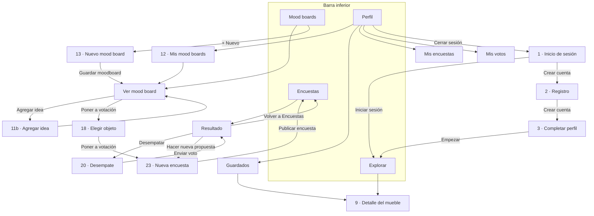

# Guía de Roomies Deco

App para que los roommates de una casa decidan juntos cómo decorar: descubren muebles, arman mood boards y votan qué entra al espacio común.

> **Estado: Fase 2 terminada** (proyecto, tema y navegación).
> Ya se puede recorrer toda la app. Cada pantalla muestra por ahora un recuadro con su número del Figma y lo que va a tener en la Fase 3.
> Esta guía se completa en cada fase.

---

## 1. Cómo instalar y ejecutar

**Necesitas:**

- **Node.js 22** (22.13 o más reciente) o **Node.js 24**. El SDK 58 de Expo no funciona con Node 20.
- La app **Expo Go** en el teléfono, actualizada desde la tienda (abre proyectos del SDK 58).

**Pasos:**

1. Instala las dependencias (solo la primera vez):

   ```bash
   npm install
   ```

2. Arranca el proyecto:

   ```bash
   npx expo start
   ```

3. Escanea el código QR que aparece en la terminal:
   - **iPhone:** con la cámara.
   - **Android:** con la app Expo Go.

El teléfono y el computador tienen que estar en la misma red Wi‑Fi. Si no se conectan (por ejemplo, en la red de la universidad), usa:

```bash
npx expo start --tunnel
```

---

## 2. Carpetas

Es la misma organización de la plantilla de clase **cafe-app**:

```
ColivingApp/
├── src/app/                 ← pantallas: cada archivo es una pantalla
│   ├── _layout.jsx          ← carga las letras y define la navegación principal (Stack)
│   ├── (tabs)/              ← las 4 pestañas de la barra inferior
│   │   ├── _layout.jsx      ← la barra inferior
│   │   └── explorar.jsx, encuestas.jsx, moodboards.jsx, perfil.jsx
│   └── ...                  ← el resto de pantallas (ver la sección 4)
├── assets/
│   ├── Components/          ← componentes reutilizables, uno por archivo
│   ├── Styles/
│   │   ├── Tema.jsx         ← colores, letras, bordes y espacios del Figma
│   │   └── Stylesheet.jsx   ← todos los estilos (StyleSheet.create)
│   └── images/              ← ícono de la app y pantalla de carga
├── app.json                 ← nombre, ícono y colores de la app
├── package.json             ← librerías que usa el proyecto
├── FASE-1-propuesta.md      ← propuesta aprobada en la Fase 1
├── NOTAS-FIGMA.md           ← códigos de cada pantalla y foto del Figma
└── GUIA.md                  ← esta guía
```

En las próximas fases se agregan dentro de `assets/` las carpetas `Datos/`, `Servicios/`, `Logica/` y `Contexto/`, como dice la propuesta.

---

## 3. Tema: colores y letras del Figma

Todos los valores del diseño están en **un solo archivo**, `assets/Styles/Tema.jsx`. Si el Figma cambia, se cambia ahí y toda la app se actualiza.

| Grupo | Qué tiene | Ejemplo |
|---|---|---|
| `colores` | Los 12 colores del Figma | `colores.principal` = `#D9653B` (terracota) |
| `fuentes` | Los nombres de las 4 letras | `fuentes.poppinsBold` |
| `letras` | Los 7 estilos de texto: letra, tamaño y alto de línea | `letras.titulo` = Poppins Bold 22 |
| `bordes` | Bordes redondeados | `bordes.normal` = 16 |
| `espacios` | Márgenes y separaciones | `espacios.normal` = 16 (margen a los lados) |

`assets/Styles/Stylesheet.jsx` arma los estilos con esos valores, agrupados como en la plantilla: `general`, `boton`, `chip`, `encabezado`, `barraInferior`, `estadoVacio` e `inicio`.

Se usan así:

```jsx
import { general } from "../../assets/Styles/Stylesheet";

<Text style={general.titulo}>Mood boards</Text>
```

En `Stylesheet.jsx` vas a ver `...letras.titulo`. Los tres puntos copian dentro del estilo la letra, el tamaño y el alto de línea que están en `Tema.jsx`.

**Letras:** Poppins (títulos) e Inter (textos), de `@expo-google-fonts`. Se cargan en `src/app/_layout.jsx` con `useFonts`, y mientras cargan no se muestra nada.

**Íconos:** [Lucide](https://lucide.dev) (`lucide-react-native`), los mismos del Figma:

| Dónde | Ícono |
|---|---|
| Pestaña Explorar | `Compass` |
| Pestaña Encuestas | `Folder` |
| Pestaña Mood boards | `LayoutGrid` |
| Pestaña Perfil | `User` |
| Botón volver | `ArrowLeft` |
| Logo | `House` |

---

## 4. Navegación

La app usa **Expo Router**: cada archivo dentro de `src/app` es una pantalla y su ruta es el nombre del archivo. Por ejemplo, `src/app/registro.jsx` es la pantalla `/registro`.

- **`_layout.jsx`** define cómo se pasa de una pantalla a otra. El de `src/app` es un **Stack**: cada pantalla nueva se pone encima de la anterior y se puede volver. El de `(tabs)` es la **barra inferior**.
- **Los paréntesis** en `(tabs)` agrupan pantallas sin cambiar la ruta: `(tabs)/explorar.jsx` es `/explorar`.
- **`[id]`** en el nombre significa que la pantalla recibe un dato. Por ejemplo, `/mueble/m1` abre `mueble/[id].jsx` con `id = "m1"`. La pantalla lo lee así:

  ```jsx
  const { id } = useLocalSearchParams();
  ```

### Pantallas

| Archivo (`src/app/…`) | Ruta | Pantalla del Figma |
|---|---|---|
| `index.jsx` | `/` | 1 · Inicio de sesión (la primera pantalla) |
| `registro.jsx` | `/registro` | 2 · Registro |
| `completar-perfil.jsx` | `/completar-perfil` | 3 · Completar perfil |
| `(tabs)/explorar.jsx` | `/explorar` | 4, 6, 7, 8 · Explorar |
| `(tabs)/encuestas.jsx` | `/encuestas` | 22 · Encuestas |
| `(tabs)/moodboards.jsx` | `/moodboards` | 10, 10b · Mood boards |
| `(tabs)/perfil.jsx` | `/perfil` | 26 · Perfil |
| `mueble/[id].jsx` | `/mueble/m1` | 9 · Detalle del mueble |
| `moodboard/nuevo.jsx` | `/moodboard/nuevo` | 13 · Nuevo mood board |
| `moodboard/[id].jsx` | `/moodboard/mb1` | 11, 14, 15, 17 · Ver un mood board |
| `agregar-idea/[id].jsx` | `/agregar-idea/mb1` | 11b · Agregar idea |
| `elegir-objeto/[id].jsx` | `/elegir-objeto/mb1` | 18 · Poner a votación |
| `encuesta/nueva.jsx` | `/encuesta/nueva` | 23 · Nueva encuesta |
| `encuesta/[id].jsx` | `/encuesta/e1` | 24, 25, 25b, 19, 21 · Resultado |
| `desempate/[id].jsx` | `/desempate/e1` | 20 · Votación de desempate |
| `mis-moodboards.jsx` | `/mis-moodboards` | 12 · Mis mood boards |
| `guardados.jsx` | `/guardados` | (nueva) Muebles guardados |
| `mis-encuestas.jsx` | `/mis-encuestas` | (nueva) Encuestas que creé |
| `mis-votos.jsx` | `/mis-votos` | (nueva) Votos que di |

### Flujo entre pantallas



### Cómo se cambia de pantalla

Todas las funciones vienen de `router` (`import { router } from "expo-router"`):

| Función | Qué hace | Dónde se usa |
|---|---|---|
| `router.push("/registro")` | Abre una pantalla encima de la actual; se puede volver | Casi todos los botones |
| `router.back()` | Vuelve a la pantalla anterior | Botón volver del `Encabezado`, botones Cancelar, Desempate y Agregar idea |
| `router.replace("/explorar")` | Cambia la pantalla actual por otra; no se puede volver a la anterior | Iniciar sesión, Cerrar sesión, Guardar moodboard |
| `router.dismissAll()` | Cierra todas las pantallas de encima hasta la primera | Completar perfil → Empezar |
| `router.dismissTo("/encuestas")` | Cierra pantallas hasta llegar a esa ruta | Publicar encuesta, Volver a Encuestas |

Ejemplo: al tocar **Empezar** en Completar perfil se usan `dismissAll()` y después `replace("/explorar")`. Así el botón "atrás" no vuelve al registro.

---

## 5. Componentes (hasta ahora)

Están en `assets/Components`. Cada uno es una función con sus props entre llaves y `export default` al final, como `ProductoItem` en la plantilla. En esta fase se hicieron los 4 que necesita la navegación; los otros 16 de la propuesta llegan en la Fase 3.

| Componente | Para qué sirve | Props |
|---|---|---|
| `Boton` | Botón grande naranja o blanco con borde naranja | `texto`, `alPresionar`, `tipo` (`"principal"` o `"secundario"`), `deshabilitado` |
| `Chip` | Botón pequeño redondeado (filtros y "+ Nuevo") | `texto`, `seleccionado`, `alPresionar` |
| `Encabezado` | Título de la pantalla, con o sin flecha para volver | `titulo`, `subtitulo`, `conVolver`, `botonDerecha` |
| `EstadoVacio` | Mensaje cuando una lista está vacía | `titulo`, `mensaje` |

Ejemplo de uso:

```jsx
<Encabezado
  titulo="Moodboards"
  botonDerecha={<Chip texto="+ Nuevo" seleccionado={true} alPresionar={irANuevoMoodboard} />}
/>
```

Los botones usan `TouchableOpacity`, que se aclara un poco al tocarlo.

---

## 6. Decisiones tomadas donde el Figma no era explícito

| Tema | Decisión |
|---|---|
| Versión de Expo | **SDK 58**, la más reciente. La plantilla de clase usa el 57, pero la app Expo Go de la tienda abre el SDK más reciente, que es el 58. |
| Nombre de la app | **Roomies Deco**. Se cambia en `app.json` (`name`). |
| Ícono y pantalla de carga | Se hicieron con el logo del login del Figma: la casa blanca sobre el cuadrado terracota. |
| Modo oscuro | No hay: el Figma solo tiene modo claro (`"userInterfaceStyle": "light"` en `app.json`). |
| Barra inferior | Se usa `Tabs` de `expo-router/js-tabs` y no `NativeTabs`. La barra nativa no deja poner los íconos de Lucide ni el texto activo más grande, como en el Figma. |
| Relleno de las pestañas | Se quita el relleno lateral que pone la librería (`tabBarButton` en `(tabs)/_layout.jsx`). Sin ese cambio, "Mood boards" no cabía en una línea. |
| Título de "Agregar idea" | En el Figma esa pantalla tiene flecha y título de 28. Se usa 22, como en las demás pantallas con flecha. |
| Espacio de arriba | Cada pantalla usa `SafeAreaView` para no quedar debajo de la hora y la batería. Las pestañas usan `edges={["top"]}` porque abajo ya está la barra. |

---

## 7. Lo que sigue

- **Fase 3:** construir las pantallas en el orden de la lista, con los datos de prueba (`assets/Datos`) y el contexto compartido (`assets/Contexto`).
- **Fase 4:** lógica de votación, desempate y sugerencias.
- **Fase 5:** revisión final y esta guía completa: modelo de datos, votación paso a paso y cómo conectar un backend real.
